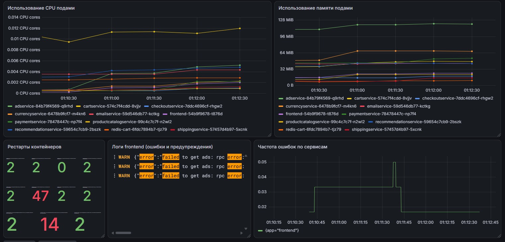

# Microservices Observability & Reliability Platform

SRE-стенд на Kubernetes: наблюдаемость, SLO и хаос-эксперименты на демо-магазине [Online Boutique](https://github.com/GoogleCloudPlatform/microservices-demo).

Полноценный SRE-стенд, развернутый локально на Kubernetes, демонстрирующий практики обеспечения надежности микросервисных приложений: от определения SLI/SLO и алертинга по Burn Rate до хаос-экспериментов с разбором результатов.

**Быстрый переход:** [Хаос-эксперименты](#хаос-эксперименты) · [Архитектура](#архитектура-системы) · [SLO и алерты](#slo-и-алерты) · [Быстрый старт](#быстрый-старт)



## Стек технологий

| Область | Инструменты |
|---|---|
| Оркестрация | Kubernetes (kind), Docker, Helm |
| Метрики и алерты | Prometheus, kube-prometheus-stack, Alertmanager, Grafana, blackbox-exporter |
| Логи | Grafana Loki, Grafana Alloy |
| Кастомная разработка | Python (requests, prometheus-client), Docker |
| Уведомления | Telegram |
| SRE-практики | SLI/SLO, Error Budget, Burn Rate Alerting, синтетический мониторинг, Chaos Engineering |

## Хаос-эксперименты

Каждый эксперимент оформлен как отчет с гипотезой, действиями, скриншотами метрик, TTD, выводом и пунктами улучшений (action items). Два эксперимента закончились **найденной слабостью, исправлением и повторной проверкой**.

| # | Эксперимент | Что показал |
|---|---|---|
| [1](chaos/2026-10-19/2026-10-19-incident-frontend-down.md) | **Полная недоступность витрины.** `frontend` до 0 реплик | Проверка срабатывания Burn Rate алертов. Алерт не мгновенный: окну нужно накопить бюджет ошибок |
| [2](chaos/2026-10-21/2026-10-21-incident-cartservice-down-frontend-up.md) | **Скрытая жесткая зависимость.** `cartservice` до 0 реплик | Главная отдает HTTP 500, хотя поды `frontend` живы. Blackbox видит сбой, Kubernetes нет |
| [3](chaos/2026-10-22/2026-10-22-incident.md) | **Частичный отказ пути.** `paymentservice` до 0 реплик | Blackbox молчит (главная работает), но синтетический сценарий падает на шаге `checkout` |
| [4](chaos/2026-10-23/2026-10-23-incident-journey-exporter-down.md) | **Слепая зона мониторинга.** падение самого `journey-exporter` | SLO-алерты молчат, потому что метрики исчезают. Добавлен алерт `JourneyExporterDown` на `absent()`, повторный прогон его подтвердил |
| [5](chaos/2026-10-24/2026-10-24-incident-bad-deploy.md) | **Плохой деплой.** образ с несуществующим тегом | Rolling Update спасает пользователей, но деплой застревает в `ImagePullBackOff`. Добавлен алерт `K8sDeploymentStuck`, повторный прогон его подтвердил |
| [6](chaos/2026-10-24/2026-10-25-incident-adservice-down.md) | **Graceful Degradation.** `adservice` и `recommendationservice` до 0 реплик | Некритичные зависимости не валят витрину: страницы работают без блоков рекламы и рекомендаций |


### Главные выводы

1. **Ни один источник сигнала не покрывает все отказы.** Kubernetes не видит влияния на пользователя (эксперимент 2), blackbox не видит сбоев вне главной страницы (эксперимент 3), синтетический сценарий не видит собственной смерти (эксперимент 4). Нужны все три.
2. **Тишина мониторинга не означает "все хорошо".** Алерты считаются по метрикам, и при исчезновении данных они молчат, поэтому за источниками данных тоже нужно следить.
3. **Обнаружение и доставка измеряются отдельно.** Prometheus переводил алерты в `FIRING` за 2.5–6 минут, а уведомление в Telegram иногда приходило с задержкой до 14 минут из-за нестабильного прокси.
4. **Не каждый сбой виден пользователю.** Бизнес-алерты (critical) ловят страдание пользователя, инфраструктурные (warning) ловят деградацию, которая пока терпима.
5. **Устойчивость определяется кодом вызывающей стороны, а не "важностью" сервиса:** отказ `cartservice` валит главную, а отказ рекомендаций нет.


## Структура репозитория

- `cluster/ `: конфигурация kind-кластера
- `exporter/`: кастомный Python-экспортер синтетического сценария (Dockerfile, манифест)
- `monitoring/`: helm values, Probe, PrometheusRule (SLO и Burn Rate алерты), дашборд Grafana
- `chaos/`: отчеты о хаос-экспериментах со скриншотами
- `docs/`: описание SLI/SLO


## SLO и алерты

Подробно: [docs/slo.md](docs/slo.md).

| SLO | Цель | Источник |
|---|---|---|
| SLO-1 доступность витрины | 99% успешных проверок за 30 дней (бюджет ошибок 432 мин) | `probe_success{job="boutique-frontend"}` |
| SLO-2 скорость | p95 ответа главной < 1 с на окне 5 мин | `probe_duration_seconds` |

| Алерт | Условие | Уровень |
|---|---|---|
| `BoutiqueFastBurn` | burn rate 14.4: ошибки за 1 ч и за 5 мин > 14.4%, `for: 2m` | critical |
| `BoutiqueSlowBurn` | burn rate 6: ошибки за 6 ч и за 30 мин > 6%, `for: 15m` | warning |
| `BoutiqueSlowResponse` | p95 > 1 с, `for: 10m` | warning |
| `BoutiqueJourneyFailing` | доля неуспешных прогонов сценария > 20%, `for: 5m` | critical |
| `JourneyExporterDown` | `absent(journey_runs_total)`, `for: 2m` | warning |
| `K8sDeploymentStuck` | `kube_deployment_status_replicas_unavailable > 0`, `for: 5m` | warning |

Последние два алерта появились как исправления по итогам экспериментов 4 и 5.

## Быстрый старт

Требования: Docker, kind, kubectl, Helm.

```bash
# 1. Кластер
kind create cluster --config cluster/kind-config.yaml

# 2. Online Boutique в namespace boutique
kubectl create namespace boutique
kubectl apply -n boutique -f https://raw.githubusercontent.com/GoogleCloudPlatform/microservices-demo/main/release/kubernetes-manifests.yaml

# 3. Стек наблюдаемости
helm repo add prometheus-community https://prometheus-community.github.io/helm-charts
helm repo add grafana https://grafana.github.io/helm-charts
helm repo update
kubectl create namespace monitoring
helm install kps prometheus-community/kube-prometheus-stack -n monitoring -f monitoring/kps-values.yaml
helm install loki grafana/loki -n monitoring -f monitoring/loki-values.yaml
helm install alloy grafana/alloy -n monitoring -f monitoring/alloy-values.yaml
helm install blackbox prometheus-community/prometheus-blackbox-exporter -n monitoring

# 4. Проба, правила и синтетический мониторинг
docker build -t journey-exporter:0.1.0 exporter/
kind load docker-image journey-exporter:0.1.0 --name sre-lab
kubectl apply -f monitoring/probe-frontend.yaml
kubectl apply -f monitoring/slo-rules.yaml
kubectl apply -f monitoring/journey-exporter.yaml
```

Telegram: создайте бота, положите токен в Secret `telegram-bot` и подставьте реальные `bot_token` и `chat_id` в `alertmanager.config` (в `kps-values.yaml` стоят заглушки `TOKEN` и `CHAT_ID`). Не коммитьте реальные значения.


## Ограничения и планы

**Не проверялось:** нехватка ресурсов (CPU, память, OOM), отказ узла, отказ `redis-cart`, сетевые задержки.

**Ограничения:** стенд локальный, поэтому TTD и TTR сопоставимы между экспериментами, но не переносятся на продакшн. Доставка уведомлений идет через сторонний прокси Telegram API и бывает нестабильной.

**Планы:**
- алерт `replicas_available == 0` для некритичных сервисов;
- Watchdog во внешний сервис и второй канал уведомлений;
- runbook'и для критичных алертов;
- эксперимент с сетевой задержкой для `BoutiqueSlowResponse`.