# Хаос-эксперимент 1: Полная недоступность витрины Online Boutique (frontend down)
**Дата:** 19 октября 2026 (понедельник)
**Серьезность:** Р1 / критический (витрина полностью недоступна)
**Сервис:** `frontend`
**Алерт:** `BoutiqueFastBurn` и `BoutiqueJourneyFailing`
-----
## **Цель:**
Проверить, что система мониторинга (blackbox-exporter и синтетический экспортер) корректно фиксирует полную недоступность витрины, накапливает статистику ошибок и отправляет алерт в Telegram в соответствии с заданными параметрами SLO (burn rate 14.4, окно 1 час).
----
## **Гипотеза:**
Если масштабируем Deployment `frontend` до 0 реплик, то:
1. Метрика `probe_success` упадет до 0.
2. Доля ошибок (`boutique:error_ratio:1h`) превысит порог 14.4%.
3. Через ~7-9 минут сработает алерт `BoutiqueFastBurn` (и дублирующий `BoutiqueJourneyFailing`), и уведомление придет в бот Телеграмм.
4. После восстановления реплик сервис поднимется, а алерт перейдет в статус Resolved только после того, как скользящее окно забудет период простоя.
----
## **Действия:**

### 1. Зафиксировать время начала эксперимента: **23:19:07 MSK**.

### 2. Остановить витрину frontend:

```bash
kubectl scale deploy/frontend -n boutique --replicas=0
```

### 3. Наблюдать за метриками в Prometheus (probe_success, boutique:error_ratio:1h) и логами экспортера.

#### **SLO метрики после ~2m запуска.**

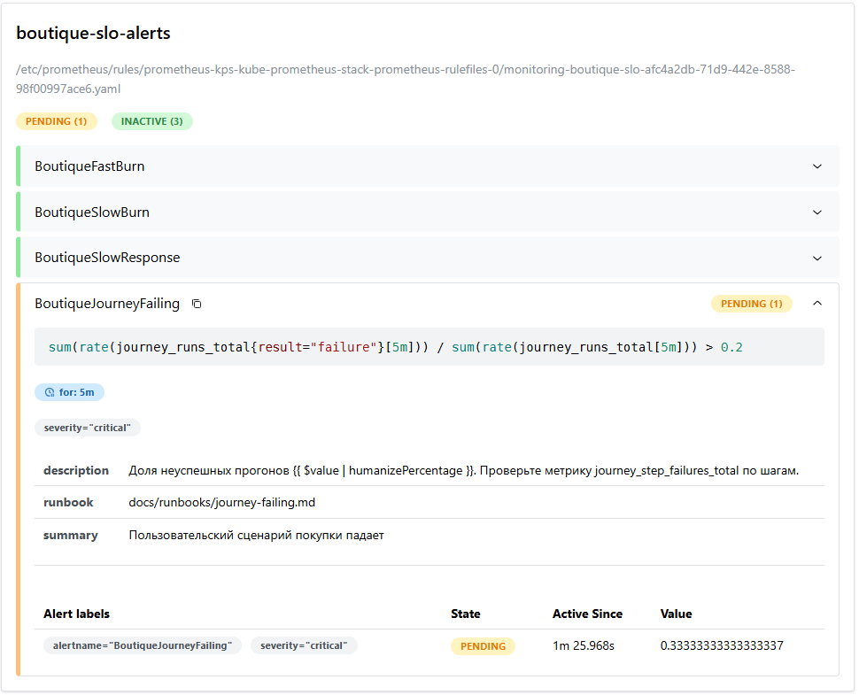

> Видно, что метрика `BoutiqueJourneyFailing` перешла в состояние `PENDING`. Для перехода в `FIRING` нужно подождать 5m (защита от ложных срабатываний, параметр for: 5m в правиле алерта).

#### **Алерты в состоянии `PENDING` через ~2 минуты после начала эксперимента.**


> `BoutiqueSlowBurn` активен 2m 24s, значение 6.6% (порог 6%). Алерты еще не перешли в `FIRING`, так как не выдержали требуемое время for: (15m для `SlowBurn`, 5m для `JourneyFailing`).

#### **Через ~3.5 минуты значения метрик продолжают расти.**

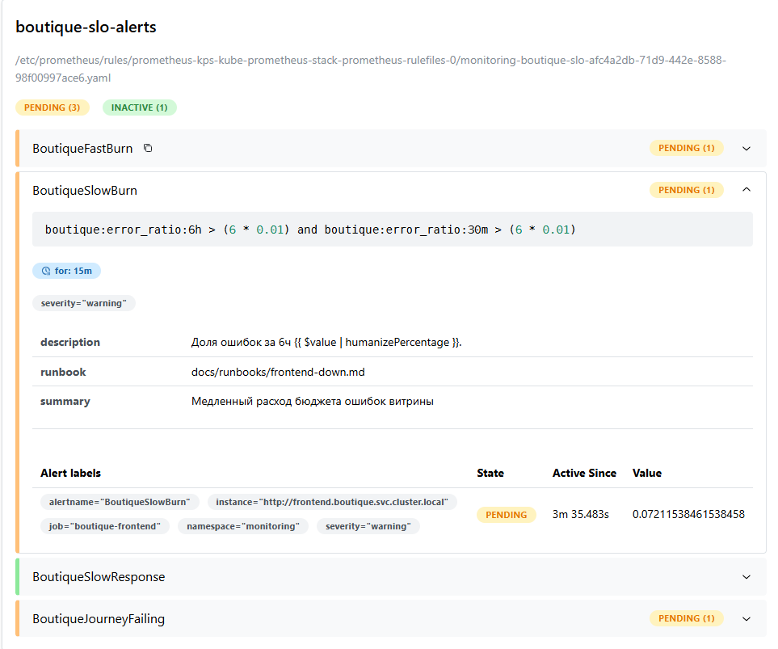

> `BoutiqueSlowBurn` активен 3m 35s, значение 7.2% (выше порога 6%). `BoutiqueFastBurn` и `BoutiqueJourneyFailing` все еще в `PENDING`. Алерты накапливают время активности, но еще не достигли порога for. Это показывает, как скользящее окно накапливает ошибки.

#### **Критический момент - все алерты перешли в состояние `FIRING`.**


> `BoutiqueFastBurn`, `BoutiqueSlowBurn`, `BoutiqueSlowResponse` и `BoutiqueJourneyFailing` активны одновременно. На скриншоте видна детальная информация по `BoutiqueJourneyFailing`: формула, время активности 5m 48s, значение 1 (100% провалов сценария). Это момент, когда Alertmanager должен отправить уведомление в Телеграмм.

#### **Итоговое состояние алертов во время инцидента.**

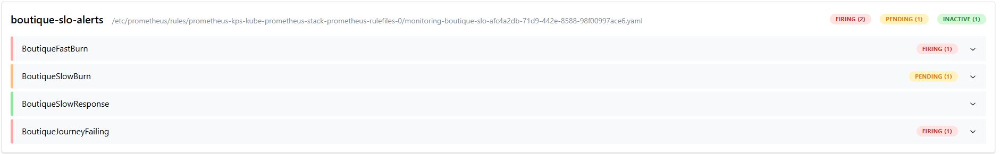

> `BoutiqueFastBurn` и `BoutiqueJourneyFailing` перешли в состояние `FIRING`, оперативно зафиксировав критическую недоступность витрины и полный провал пользовательского сценария.

> `BoutiqueSlowBurn` находится в состоянии `PENDING`, так как отрабатывает встроенную защиту от шума (требует 15 минут непрерывного превышения порога, чтобы зафиксировать медленный расход бюджета).

> `BoutiqueSlowResponse` остался `INACTIVE`, что является ожидаемым и правильным поведением: этот алерт создан для ловли медленных ответов (p95 > 1s), а при полном падении сервиса (0 реплик) blackbox получает мгновенную ошибку соединения (connection refused), а не задержку ответа.

### 4. Дождаться алерта в Телеграмм. Время оповещения: **23:26:46 MSK**.

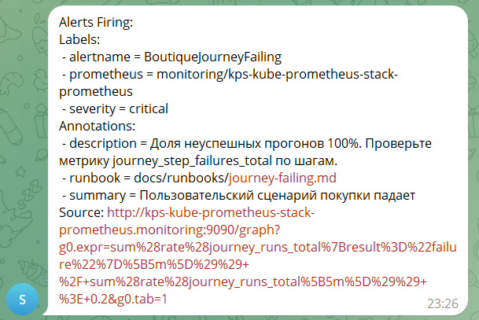
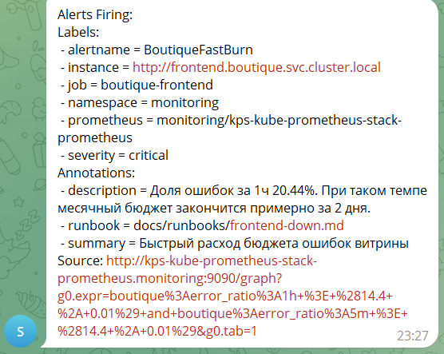

> Оба алерта имеют `severity critical` и содержат ссылки на `runbook`. Это момент обнаружения инцидента (Time to Detect).

### 5. Восстановить сервис frontend в **23:27:34 MSK**:

```bash
kubectl scale deploy/frontend -n boutique --replicas=1
```

### 6. Дождаться восстановления сервиса.

#### **Состояние алертов сразу после восстановления frontend (23:27:34).**

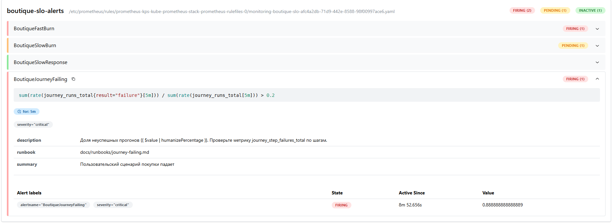

> `BoutiqueJourneyFailing` все еще в состоянии `FIRING` (активен 3m 51s), значение 8.8%. Cкользящее окно 5m все еще содержит данные о провалах сценария, поэтому алерт не гаснет мгновенно.

#### **Промежуточное состояние алертов после восстановления.**

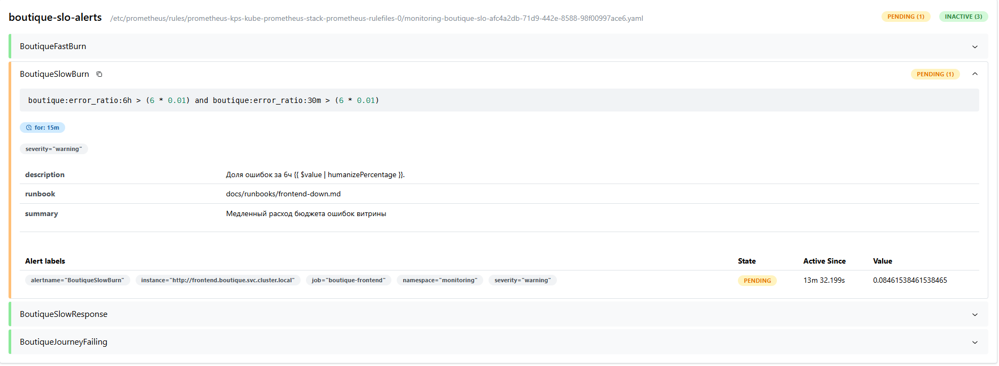

> `BoutiqueFastBurn` перешел в `PENDING` (условие больше не выполняется, но ждет окончания for: 2m). `BoutiqueSlowBurn` все еще `FIRING` (активен 13m 32s, значение 6.84%) - его окно 6h помнит все инциденты за день.

#### **Уведомления в Телеграмм о переходе алертов в статус Resolved**

Время первого оповещения: **23:37:59 MSK**.

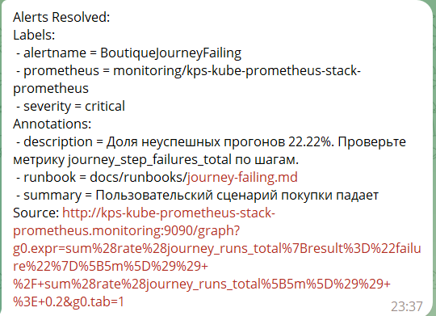
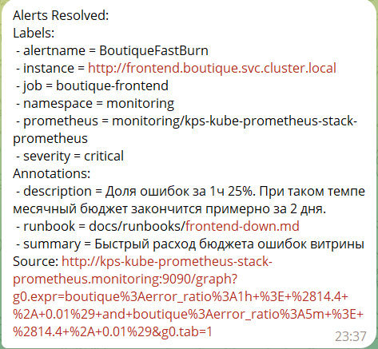
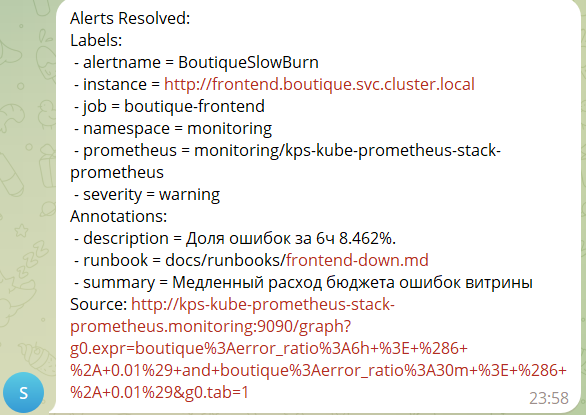

> `BoutiqueJourneyFailing` и `BoutiqueFastBurn` перешли в `Resolved` в 23:37 (через ~10 минут после восстановления). `BoutiqueSlowBurn` перешел в `Resolved` в 23:58 (через ~30 минут после восстановления).

-------

## **Итоговое состояние метрик:**
Итоговое состояние алертов после полного восстановления:

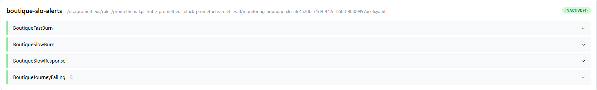

> Все четыре алерта (`BoutiqueFastBurn`, `BoutiqueSlowBurn`, `BoutiqueSlowResponse`, `BoutiqueJourneyFailing`) перешли в состояние `INACTIVE`. Система мониторинга вернулась в нормальное состояние, инцидент полностью завершен.

### Метрика probe_success:
График `probe_success{job="boutique-frontend"}` за 30 минут.

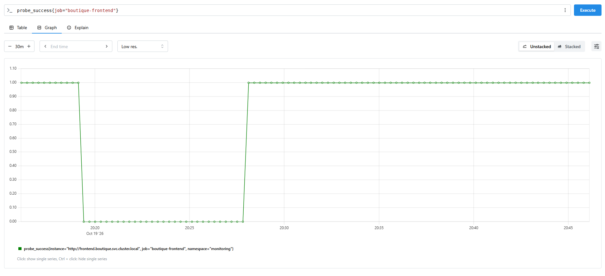

> Видно четкое падение метрики с 1 до 0 в момент остановки frontend, период недоступности длительностью ~7 минут, и восстановление до 1 после масштабирования обратно. Это визуальное подтверждение полной недоступности витрины.

### График `boutique:error_ratio:5m`:

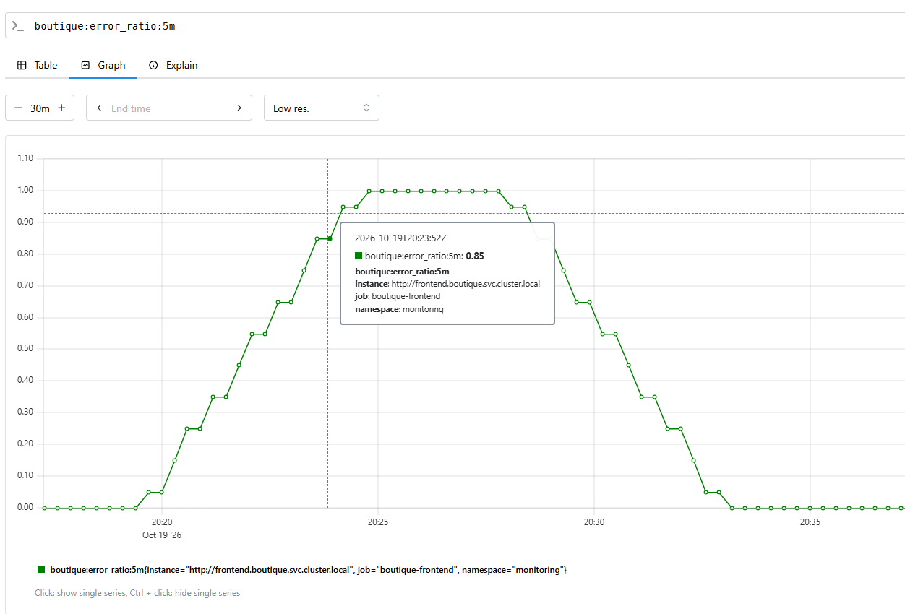

> Метрика `boutique:error_ratio:5m` - доля ошибок за скользящее 5-минутное окно. Видно резкий рост с 0 до ~85% в момент остановки frontend (23:19), пик в районе 23:25, и плавное снижение после восстановления сервиса (23:27). Эта метрика используется в условии алерта `BoutiqueFastBurn` как контрольное короткое окно.

### График `boutique:error_ratio:1h`:

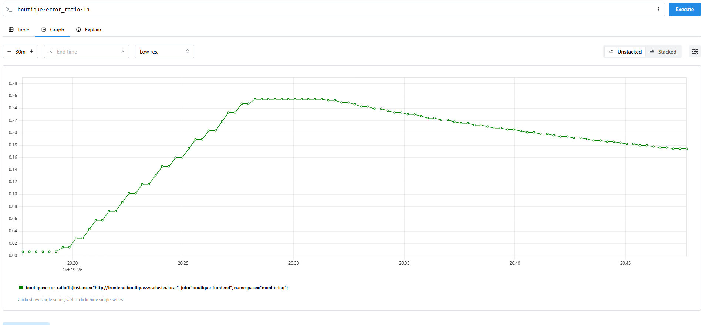

> Метрика `boutique:error_ratio:1h` - доля ошибок за скользящее часовое окно. Рост более плавный, достигает ~17-20% к моменту срабатывания алерта. После восстановления медленно снижается, но остается повышенной еще ~30 минут, пока "старые" ошибки не выйдут из часового окна. Именно эта метрика является основным индикатором `burn rate`.

### График `journey_step_failures_total{step="home"}`:

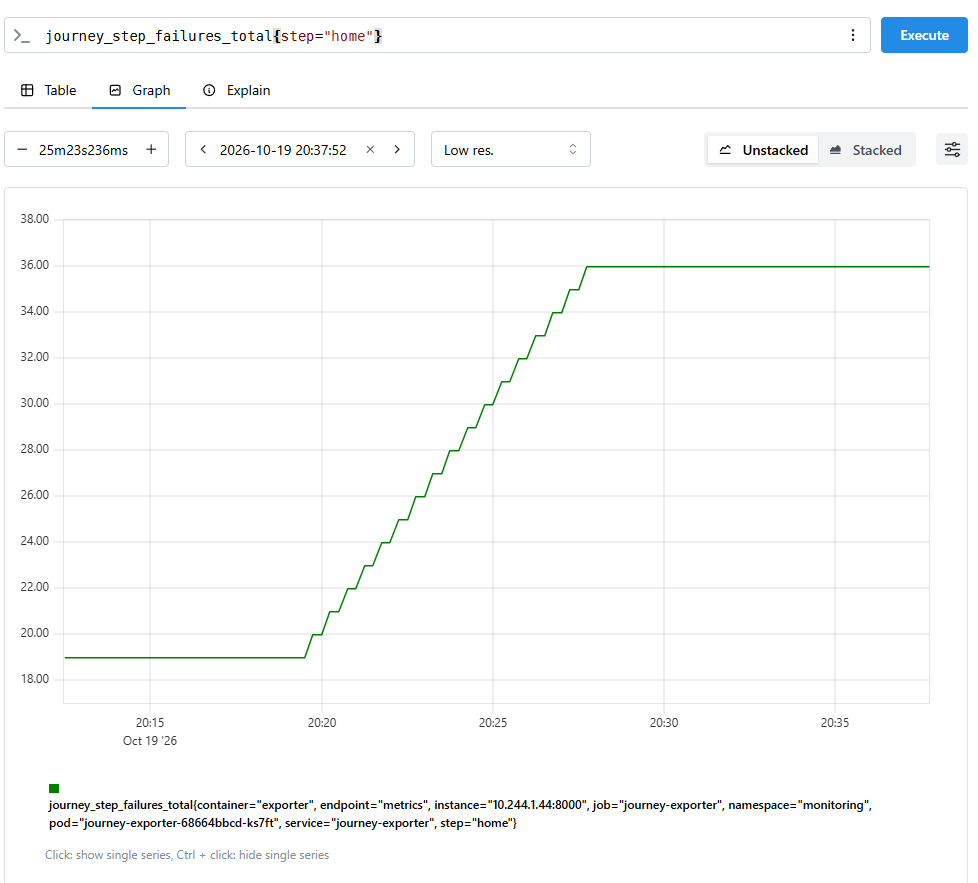

> Метрика `journey_step_failures_total{step="home"}` - счетчик провалов на шаге "открытие главной страницы". Видно линейный рост с ~19 до ~36 ошибок в период с 20:19 до 20:28. Ступенчатый график соответствует интервалу проверки 30 секунд. После 20:28 график выравнивается - сервис восстановлен, новые ошибки не накапливаются.

------

## **Ключевые SRE-метрики (TTD, TTR):**
| Метрика | Значение | Комментарий |
|---|---|---|
| **Time to Detect (TTD)** | **7 мин 39 сек** | От начала сбоя (23:19:07) до первого алерта (23:26:46) |
| **Time to Resolve (TTR)** | **8 мин 27 сек** | От начала сбоя (23:19:07) до восстановления сервиса (23:27:34) |
| **Alert lag (хвост FastBurn)** | **10 мин 25 сек** | От восстановления (23:27:34) до Resolved (23:37:59) |
| **Alert lag (хвост SlowBurn)** | **30 мин 25 сек** | От восстановления (23:27:34) до Resolved SlowBurn (23:58) |


TTD ~ 7 минут - нормальное время обнаружения. Burn rate 14.4 требует накопления статистики, чтобы отфильтровать краткосрочные сетевые проблемы и не срабатывать ложно. Это компромисс между скоростью обнаружения и надежностью алертинга.

------

## **Вывод:**

*Гипотеза полностью подтвердилась.*

Система SLO-алертинга сработала ровно так, как спроектировано:
1. `probe_success` упал до 0 сразу после масштабирования до 0 реплик.
2. Доля ошибок за час превысила порог 14.4% (достигла 20.44%).
3. Алерт `BoutiqueFastBurn` сработал через 7 минут 39 секунд (вместе с дублирующим `BoutiqueJourneyFailing`).
4. После восстановления сервис поднялся за секунды, но алерты оставались активными от 10 до 30 минут, пока скользящие окна "забывали" период простоя.

Двухуровневая защита работает корректно: blackbox зафиксировал недоступность HTTP-эндпоинта, а синтетический экспортер зафиксировал невозможность пройти пользовательский сценарий. Это страховка на случай, если один из механизмов мониторинга даст сбой.

----

## **Что можно улучшить**

- [ ] **Добавить более быстрый warning-алерт.** 7 минут TTD приемлемы для SLO, но для полной недоступности (0 реплик) можно добавить страховочный алерт вида `probe_success == 0 for 1m` с уровнем `warning`, чтобы дежурный узнавал о катастрофе быстрее, не отменяя основной burn rate алерт.
- [ ] **Автоматизация восстановления.** Настроить HPA с `minReplicas: 1` или CronJob-страховку, которая принудительно вернет реплики, если их масштаб упадёт до 0 (защита от человеческого фактора).
- [ ] **Сократить "хвост" алерта.** 30 минут до Resolved (SlowBurn) создают шум. Можно рассмотреть добавление короткого контрольного окна в выражение алерта для более быстрого гашения.
---
## **Связанные документы**

- **Runbook:** 
- **SLO:** [`docs/slo.md`](../slo.md) - SLO-1 (доступность витрины)
- **Алерты:** `monitoring/slo-rules.yaml` -> группа `boutique-slo-alerts`
