# Хаос-эксперимент 2: Сервис корзины упал, поды живы, витрина недоступна
**Дата:** 21 октября 2026 (среда)

**Серьезность:** P1 / критический (витрина недоступна, при этом под frontend в Kubernetes `Running 1/1`)

**Сервис:** `cartservice`

**Алерт:** `BoutiqueSlowBurn`, `BoutiqueFastBurn`, `BoutiqueJourneyFailing`

-----
## **Цель:**

Показать, что метрик Kubernetes недостаточно для оценки доступности сервиса: под `frontend` остаётся `Ready`, пока пользователь получает ошибку. Проверить, что внешний blackbox-мониторинг и синтетический сценарий обнаруживают сбой, который Kubernetes не видит.

----
## **Гипотеза:**
Если масштабировать `cartservice` до 0 реплик, то:
1. Под frontend останется `Running 1/1` без рестартов, потому что его пробы проверяют только `/_healthz`.
2. `probe_success` упадет до 0, потому что главная страница зависит от `cartservice` и отдает 500.
3. Сработают BoutiqueFastBurn и BoutiqueJourneyFailing.
4. `kube_pod_status_ready` для `frontend` остаётся равным 1, пока `probe_success` равна 0.

----
## **Действия:**
### 1. Зафиксировать время начала эксперимента: **18:46:21 MSK**.

### 2. Остановить сервис корзины:
```bash
kubectl scale deploy/cartservice -n boutique --replicas=0
```

### 3. Наблюдать за метриками в Prometheus.

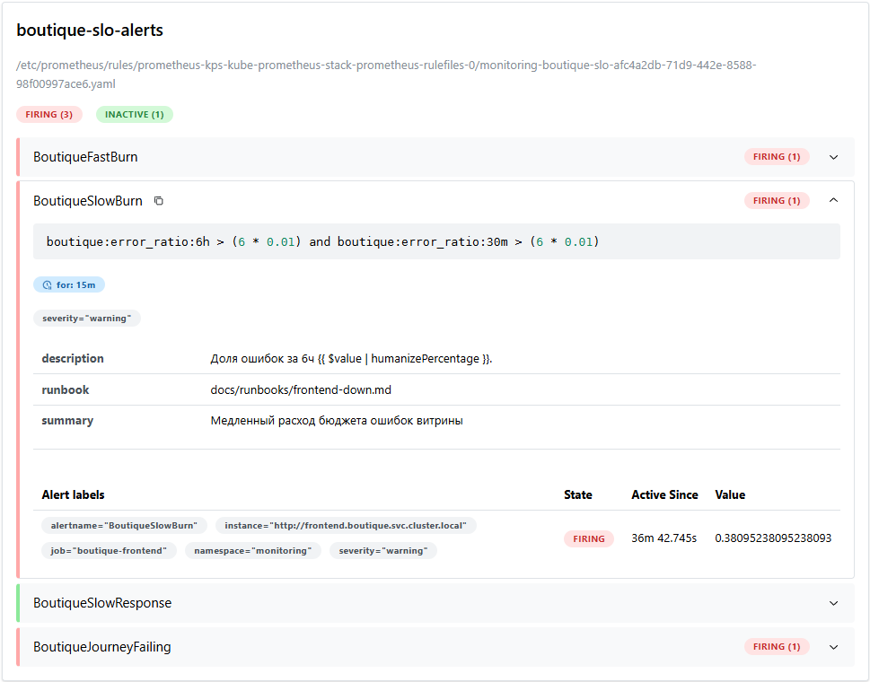

> `BoutiqueFastBurn`, `BoutiqueSlowBurn` и `BoutiqueJourneyFailing` перешли в состояние `FIRING`. `BoutiqueSlowBurn` сработал из-за накопления ошибок от нескольких запусков эксперимента (значение 38% при пороге 6%).

### 4. Дождаться алерта в Telegram. 
Время оповещения: **18:49:44 MSK**.

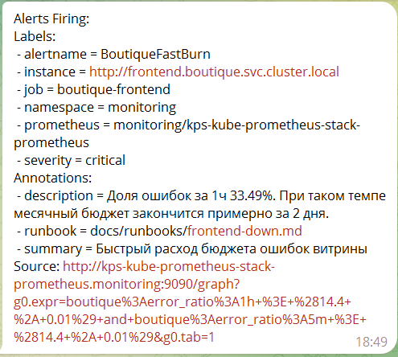
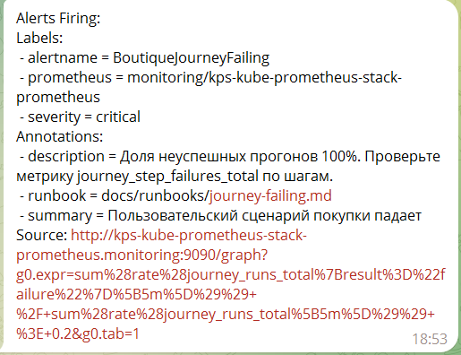


### 5.Восстановить сервис cartservice: **18:54:24 MSK**.
```bash
kubectl scale deploy/cartservice -n boutique --replicas=1
```

### 6. Дождаться восстановления сервиса и алерта Resolved.
Время оповещения: **19:04:55 MSK**.

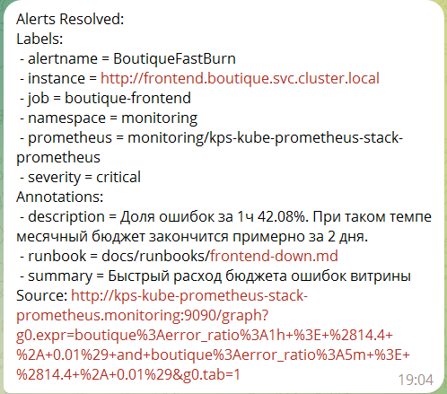
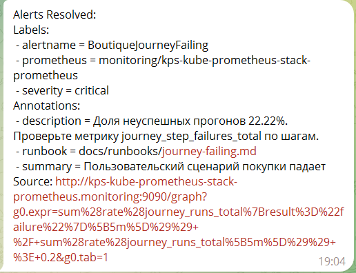
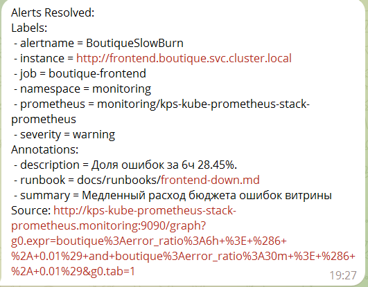


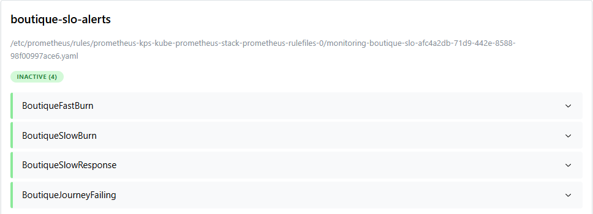


----
## **Итоговое состояние метрик:**
### **Kubernetes: под frontend жив**

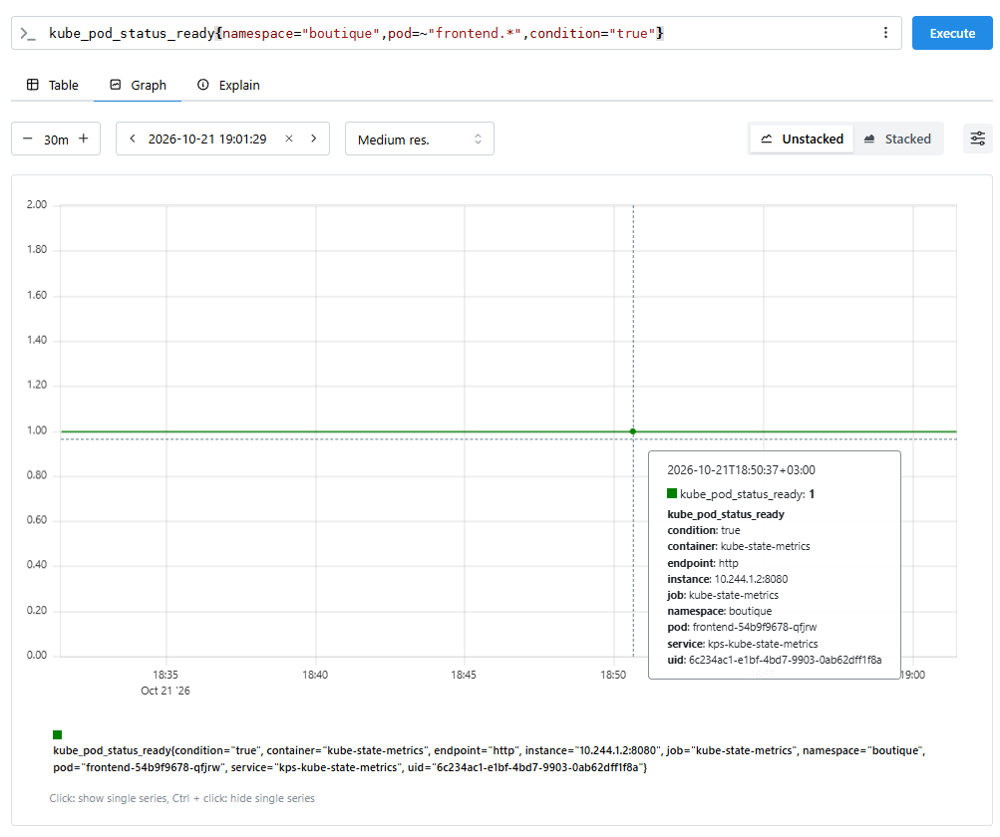

> `kube_pod_status_ready = 1` на протяжении всего эксперимента. Kubernetes считает под frontend готовым. `Liveness/readiness` пробы проверяют только `/_healthz`, который возвращает 200 даже при недоступности `cartservice`.

### **Kubernetes: рестартов пода frontend нет**

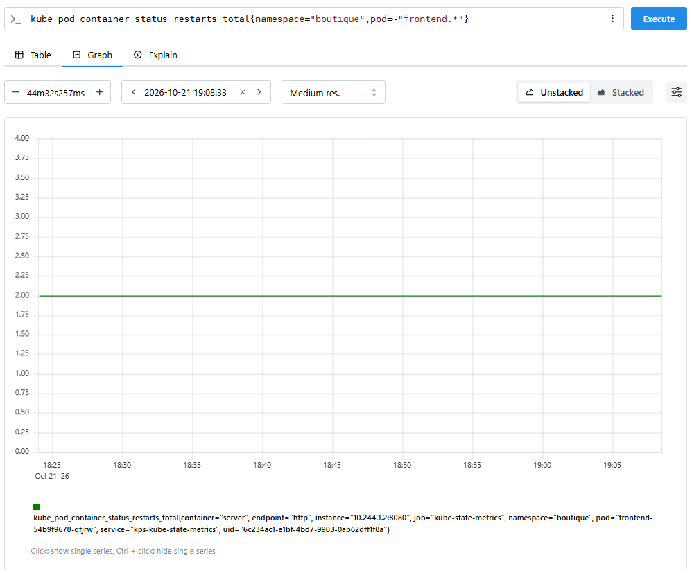

> Метрика остается ровной линией. `Frontend` не падал и не перезапускался, он возвращал `HTTP 500` на запросы к главной странице.

### **Корзина лежит**

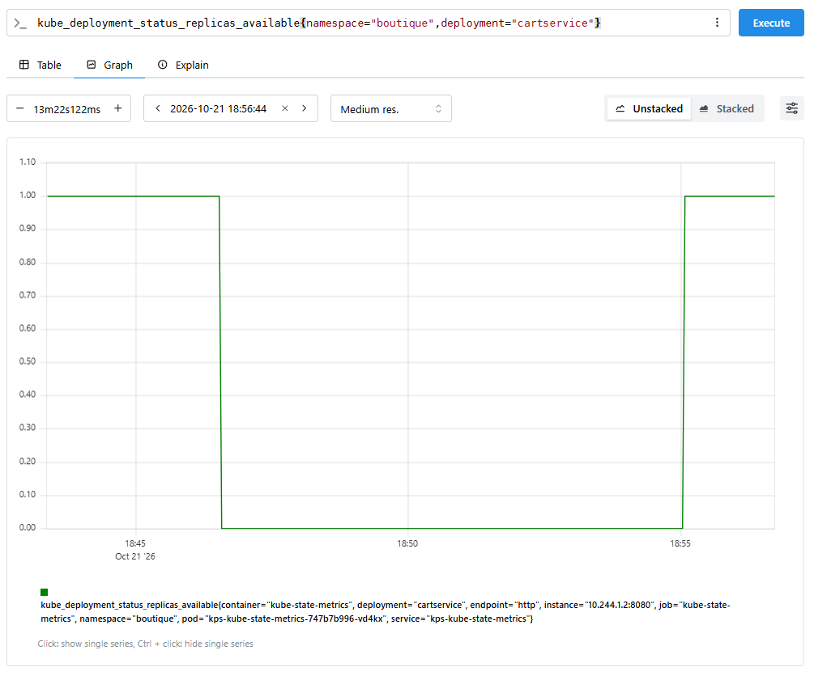

> Метрика падает до 0 в момент остановки `cartservice` и восстанавливается после масштабирования обратно.

### **Витрина недоступна (blackbox)**

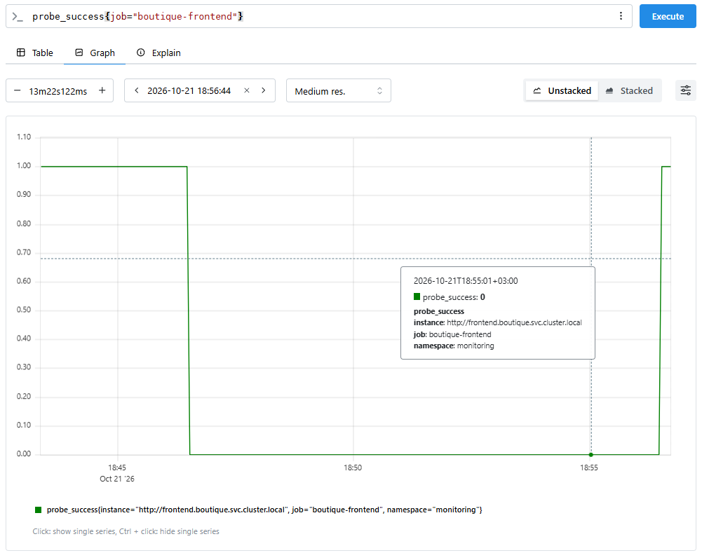

> `probe_success` упал с 1 до 0 в момент остановки `cartservice`. `Blackbox` зафиксировал полную недоступность витрины.

### **Код ответа frontend**

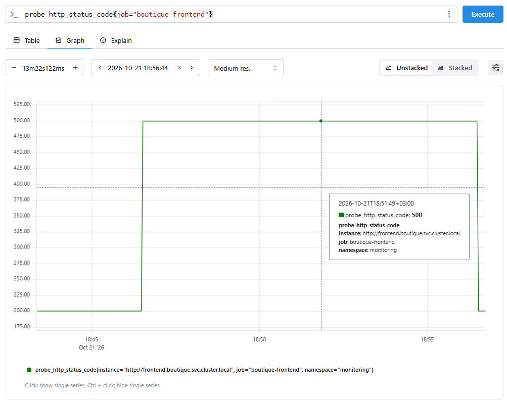

> `Frontend` вернул `HTTP 500`. В Online Boutique отказ `cartservice` приводит к ошибке на главной странице: корзина является жёсткой зависимостью, graceful degradation нет.

### **Сценарий падает**

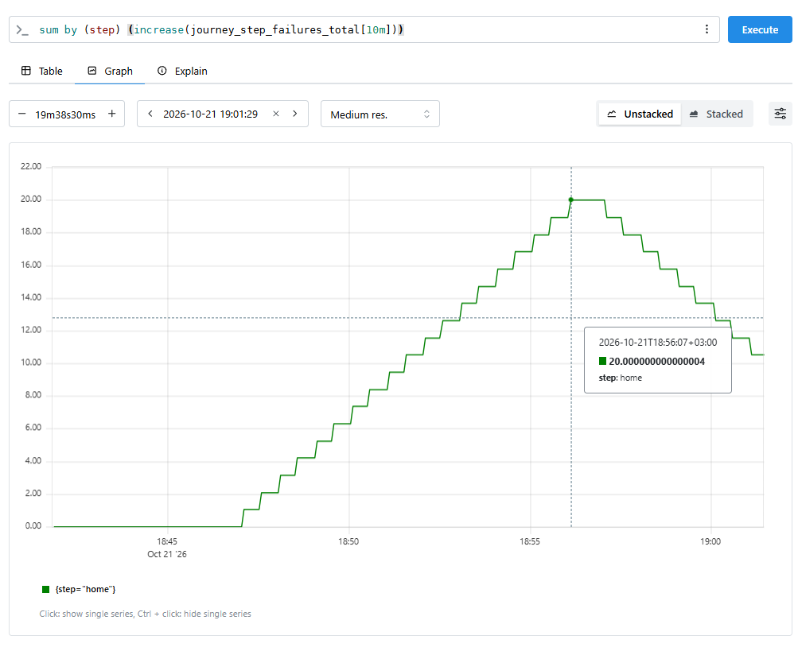

> Провалы происходят на шаге `home` (открытие главной страницы), а не на `add_to_cart`. Это подтверждает, что `frontend` возвращает 500 уже на главной.

### **Доля неуспешных прогонов**

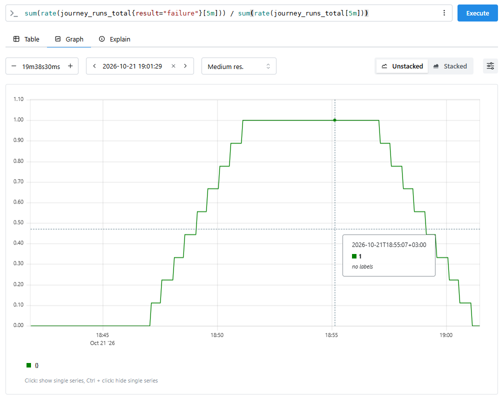

> Доля провалов достигла 100%. Порог алерта `BoutiqueJourneyFailing` - 20%, поэтому алерт сработал быстро.

---
## **Ключевые SRE-метрики (TTD, TTR):**

| Метрика | Значение | Комментарий |
|---|---|---|
| **Time to Detect (TTD)** | **~3 мин** | От начала сбоя (18:46:21) до перехода алертов в `FIRING` по Prometheus |
| **Time to Notify** | **~23 сек** | От `FIRING` до уведомления в Telegram (18:49:44) |
| **Time to Resolve (TTR)** | **8 мин 03 сек** | От начала сбоя (18:46:21) до восстановления сервиса (18:54:24) |
| **Alert lag (хвост FastBurn)** | **10 мин 31 сек** | От восстановления (18:54:24) до Resolved (19:04:55) |

TTD ~ 3.5 минуты заметно меньше, чем в эксперименте 1 (7 мин 39 сек). Это не показатель того, что алертинг стал быстрее, а следствие условий запуска: эксперимент проводился несколько раз подряд, и часовое окно `boutique:error_ratio:1h` еще содержало ошибки предыдущих прогонов. Порог burn rate 14.4 был достигнут быстрее, чем при "чистом" старте.

TTR ~ 8 минут определяется временем ручного вмешательства (сервис был восстановлен вручную через ~4.5 минуты после алерта), а не автоматикой. Сам сервис после `scale --replicas=1` поднимается за секунды.

`FastBurn` гаснет не сразу, пока короткое окно не очистится и не отработает `for: 2m`.

---
## **Вывод:**
*Гипотеза полностью подтвердилась.*

1. Под `frontend` все время оставался `Running 1/1`: `kube_pod_status_ready = 1`, рестартов нет. Kubernetes считал сервис здоровым, потому что его пробы проверяют только `/_healthz`, а он не зависит от `cartservice`.
2. При этом главная страница возвращала `HTTP 500`, `probe_success` упал с 1 до 0. Blackbox зафиксировал недоступность витрины, которую Kubernetes не увидел.
3. Сработали `BoutiqueFastBurn` и `BoutiqueJourneyFailing` (доля неуспешных прогонов сценария достигла 100%). `BoutiqueSlowBurn` сработал дополнительно из-за ошибок предыдущих запусков в окне 6h.
4. Метрики Kubernetes сами по себе показали только то, что у `cartservice` 0 реплик, но не показали влияние на пользователя. Чтобы ловить такие сбои по метрикам Kubernetes, нужно заранее знать все зависимости и способы отказа. Blackbox этого не требует: он фиксирует сам факт недоступности, независимо от причины.

Неожиданный результат: `cartservice` оказался жесткой зависимостью главной страницы. Падение одного бэкенда выводит из строя всю витрину, а не только корзину. Из-за этого провалы сценария накапливались на шаге `home`, а не на `add_to_cart`: `journey-exporter` обрывает сценарий на первой ошибке, и до шага корзины дело не доходит.


---
## **Что можно улучшить**

- [ ] **Graceful degradation во `frontend`.** Если `cartservice` недоступен, показывать страницу без счетчика корзины, а не отдавать 500. Тогда отказ корзины перестанет валить всю витрину.
- [ ] **Алерт на причину.** Добавить `kube_deployment_status_replicas_available{namespace="boutique"} == 0` с уровнем `warning` (для критичных сервисов). Это быстро подскажет дежурному, какой сервис упал.
- [ ] **Более быстрый алерт на полную недоступность.** `probe_success == 0 for 1m` с уровнем `warning` (повторяет вывод эксперимента 1).
- [ ] **Диагностика шагов сценария.** `journey-exporter` останавливается на первом провале, поэтому по `step` нельзя определить, что ломается дальше по цепочке. Можно выполнять шаги независимо друг от друга или добавить отдельные проверки зависимостей.
- [ ] **Воспроизводимость.** Перед запуском дожидаться, пока `boutique:error_ratio:1h` и `6h` вернутся к нулю, иначе TTD и срабатывание `SlowBurn` искажаются прошлыми запусками.

---
## **Связанные документы**

- **Runbook:** [frontend-down.md](/docs/runbooks/frontend-down.md), [journey-failing.md](/docs/runbooks/journey-failing.md)
- **SLO:** [`docs/slo.md`](/docs/slo.md) - SLO-1 (доступность витрины)
- **Алерты:** `monitoring/slo-rules.yaml` -> группа `boutique-slo-alerts`
- **Эксперимент 1:** [`2026-10-19-incident-frontend-down.md`](/chaos/2026-10-19/2026-10-19-incident-frontend-down.md)