# Хаос-эксперимент 3: Сервис оплаты упал, витрина открывается, а покупка невозможна
**Дата:** 22 октября 2026 (четверг)

**Серьезность:** P2 / High (витрина доступна, но оформить заказ нельзя)

**Сервис:** `paymentservice`

**Алерт:** `BoutiqueJourneyFailing`

-----
## **Цель:**

Показать обратную ситуацию по сравнению с экспериментом 2. Там blackbox поймал сбой, потому что главная страница зависела от `cartservice`. Здесь отказ затрагивает только оформление заказа, и blackbox, который проверяет главную, ничего не заметит. Проверить, что такой сбой обнаруживает синтетический мониторинг пользовательского сценария.

----
## **Гипотеза:**
Если масштабировать `paymentservice` до 0 реплик, то:
1. Под `frontend` останется `Running 1/1`, `kube_pod_status_ready` будет равен 1.
2. `probe_success` останется равным 1: главная страница не зависит от `paymentservice`.
3. `BoutiqueFastBurn` не сработает, так как считается по `probe_success`.
4. `journey_step_failures_total{step="checkout"}` начнет расти, шаги `home`, `product`, `add_to_cart` ошибок не накопят.
5. `BoutiqueJourneyFailing` сработает примерно через 6-7 минут: доля неуспешных прогонов превысит 20% примерно через минуту, затем отработает `for: 5m`.
6. После восстановления алерт перейдет в `Resolved` не сразу, а когда 5-минутное окно очистится от провалов.


----
## **Действия:**
### 1. Зафиксировать время начала эксперимента: **22:24:59 MSK**.

### 2. Остановить сервис оплаты:
```bash
kubectl scale deploy/paymentservice -n boutique --replicas=0
```

### 3. Наблюдать за метриками в Prometheus.

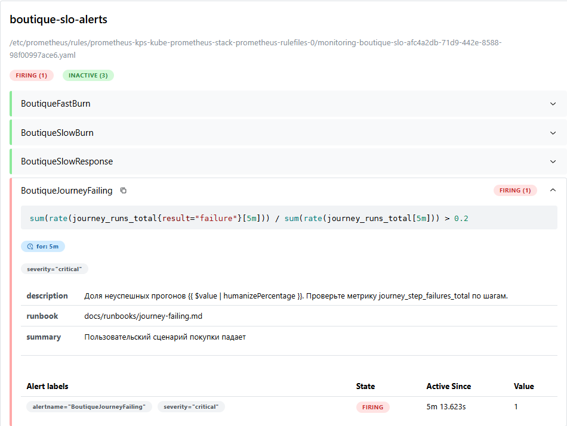


### 4. Дождаться алерта в Телеграмм. 
Время оповещения: **22:34:50 MSK**.

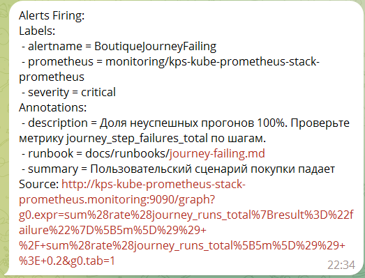

### 5.Восстановить сервис paymentservice: **22:37:19 MSK**.
```bash
kubectl scale deploy/paymentservice -n boutique --replicas=1
```

### 6. Дождаться восстановления сервиса и алерта Resolved.
Время оповещения: **22:48:25 MSK**.

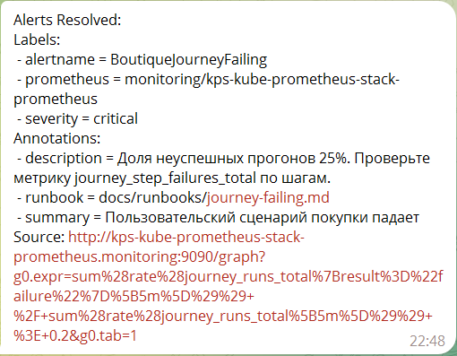

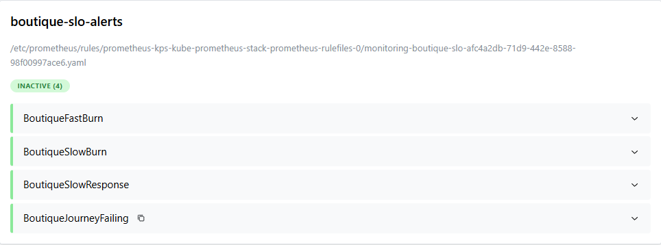

----
## **Итоговое состояние метрик:**
### **Kubernetes: под frontend жив**

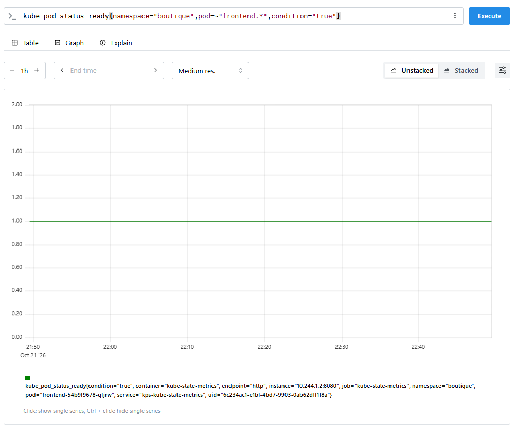

> `kube_pod_status_ready = 1` на протяжении всего эксперимента. Kubernetes считает под frontend готовым. `Liveness/readiness` пробы проверяют только `/_healthz`, который возвращает 200 даже при недоступности `paymentservice`.

### **Корзина здорова, оплата лежит**

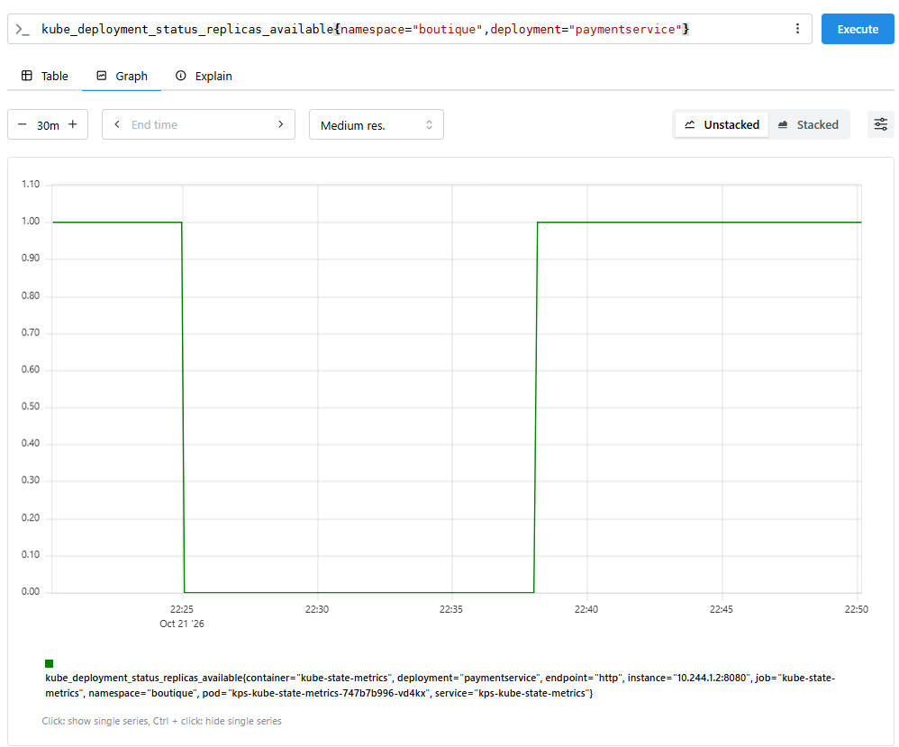

> Метрика падает до 0 в 22:25 и восстанавливается в 22:38. `Cartservice` остается доступным (1 реплика), но `paymentservice` недоступен ~13 минут.

### **Витрина доступна (blackbox)**

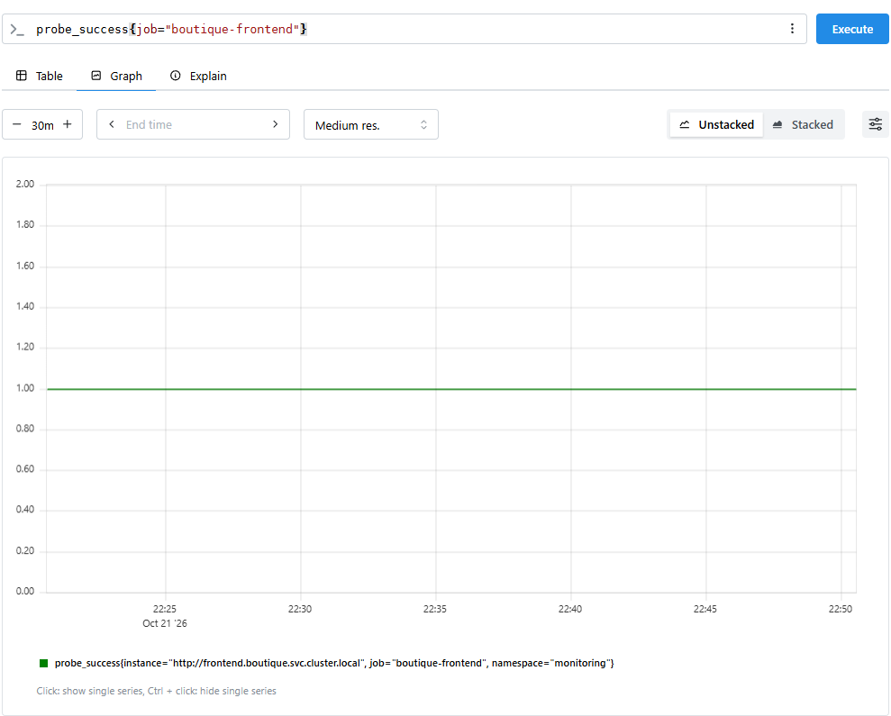

> `probe_success = 1` на протяжении всего эксперимента. Blackbox-exporter не заметил проблему - главная страница открывается, витрина работает. Это ключевое отличие от эксперимента 2, где падение `cartservice` приводило к HTTP 500.

### **Сценарий падает на шаге checkout**

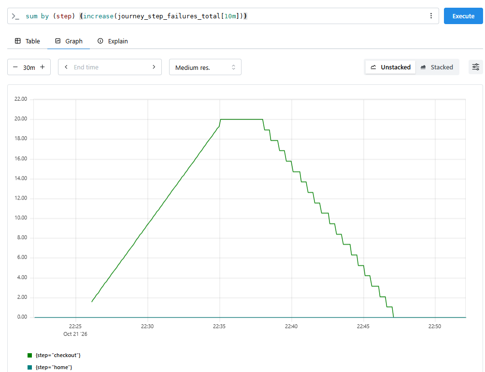

> Провалы происходят на шаге `checkout` (оформление заказа), а не на `home` или `add_to_cart`. Journey-exporter успешно проходит шаги home - product - add_to_cart, но падает на checkout, так как paymentservice недоступен.

### **Доля неуспешных прогонов**

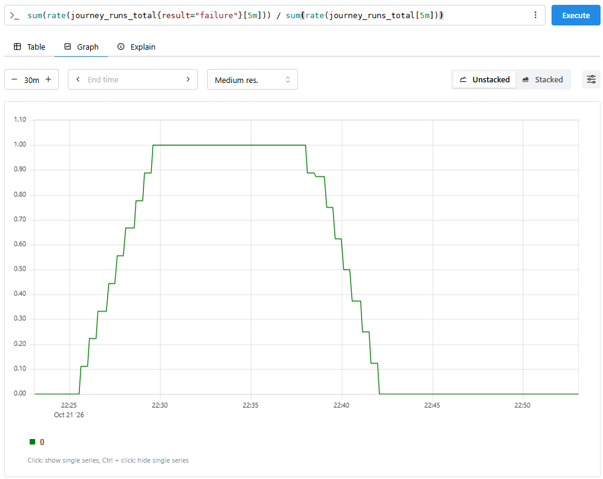

> Доля провалов достигла 100% к 22:30. Порог алерта `BoutiqueJourneyFailing` 20%, поэтому алерт сработал быстро.

### **Время с последнего успешного прогона**

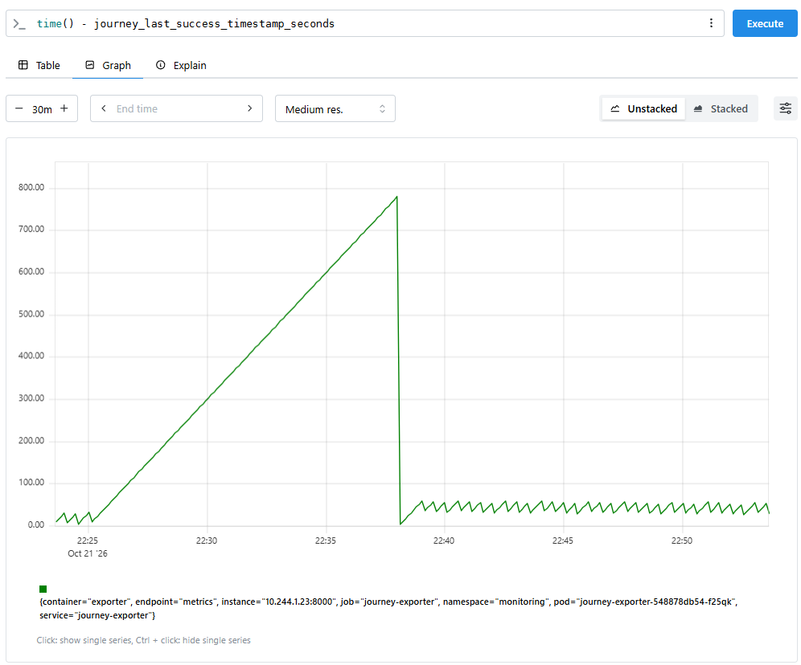


> После остановки `paymentservice` метрика начинает линейно расти, достигая пика **~780 секунд (~13 минут)** к моменту восстановления. Это означает, что в течение 13 минут ни один пользовательский сценарий не завершился успешно.
> После восстановления `paymentservice` (22:38) метрика резко сбрасывается до 0 и возвращается к нормальным колебаниям (~0-50 сек).
> Эта метрика дает интуитивно понятную картину — "последний успешный прогон был X секунд назад". Если значение растет линейно, значит система полностью не может обслуживать пользователей. Такой график можно вынести на дашборд как ключевой индикатор здоровья бизнес-логики.

---
## **Ключевые SRE-метрики (TTD, TTR):**

| Метрика | Значение | Комментарий |
|---|---|---|
| **Time to Detect (TTD)** | **~ 6 мин 30 сек** | От начала сбоя (22:24:59) до перехода `BoutiqueJourneyFailing` в `FIRING` по Prometheus (22:31:12) |
| **Time to Notify** | **~ 3 мин 20 сек** | От `FIRING` (22:31:12) до уведомления в Телеграмм (22:34:50) |
| **Time to Resolve (TTR)** | **12 мин 20 сек** | От начала сбоя (22:24:59) до восстановления сервиса (22:37:19) |
| **Alert lag (хвост в Prometheus)** | **~ 4 мин 40 сек** | От восстановления (22:37:19) до выхода из `FIRING` (22:41:40) |
| **Задержка Resolved** | **~ 6 мин 30 сек** | От выхода из `FIRING` (22:41:40) до уведомления Resolved (22:48:25) |

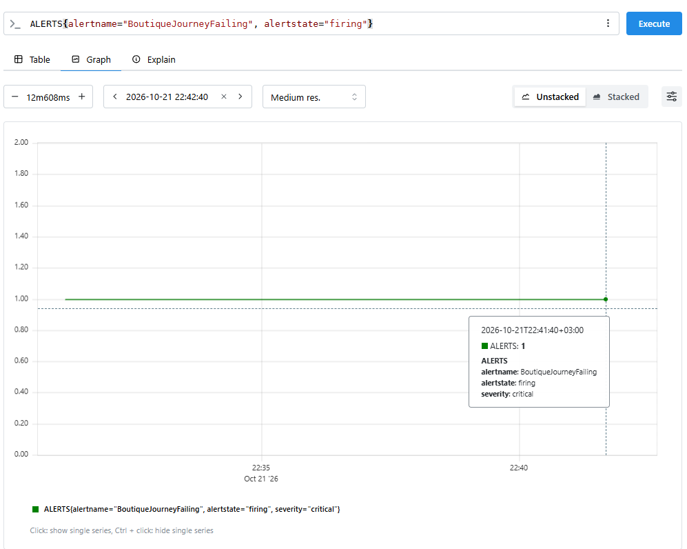

> График показывает реальные моменты перехода алерта в `FIRING` и обратно. Именно по ней измеряется TTD, а не по времени сообщений в Телеграмм.

TTD ~ 6.5 минут совпадает с расчетным из гипотезы (доля неуспешных прогонов выше 20% примерно через минуту, затем `for: 5m`). Сам алертинг в Prometheus отработал как задумано.

Между переходом алерта в `FIRING` и сообщением в Телеграмм прошло еще ~3 минуты 20 секунд, а `Resolved` пришел с задержкой ~6.5 минут. Во время эксперимента доставка уведомлений работала с заметными задержками, поэтому "время из Телеграмм" (9 мин 51 сек) не отражает скорость обнаружения.

---
## **Вывод:**
*Гипотеза подтвердилась по существу, но не по времени срабатывания.*

1. Под `frontend` все время оставался `Running 1/1`, `kube_pod_status_ready = 1`. Kubernetes не видел проблемы.
2. `probe_success = 1` на протяжении всего эксперимента: blackbox проверяет главную страницу, которая от `paymentservice` не зависит. Здесь и проявляется ограничение blackbox: он не видит сбои, которые затрагивают только часть пользовательского пути.
3. Сбой обнаружил только `journey-exporter`: провалы накапливались на шаге `checkout`, шаги `home`, `product`, `add_to_cart` проходили успешно. Сработал `BoutiqueJourneyFailing`, а `BoutiqueFastBurn` остался неактивным, так как считается по `probe_success`.
4. TTD по Prometheus составил ≈ 6.5 минут и совпал с расчетом. Уведомление дошло через 9 мин 51 сек: ~3 минуты ушли на доставку. Для критичной бизнес-функции суммарное время от сбоя до сообщения слишком велико.
5. Метрика `time() - journey_last_success_timestamp_seconds` оказалась самым наглядным индикатором: линейный рост до ~780 с показывает, что ни один сценарий не завершился успешно.

---
## **Что можно улучшить**

- [ ] **Быстрый алерт по свежести успешных прогонов.** Метрика `time() - journey_last_success_timestamp_seconds` уже есть. Алерт `> 180` с уровнем `warning` сработает через 3 минуты после последнего успешного прогона и сократит TTD примерно в три раза, не дожидаясь расчета доли и `for: 5m`.
- [ ] **Отдельный SLO для оформления заказа.** Покупка важнее открытия главной, а текущий SLO доступности (по `probe_success`) ее не отражает. SLO по `journey_runs_total` с собственными burn rate алертами даст явное измерение бизнес-функции.
- [ ] **Лейбл шага в алерте и runbook.** В `BoutiqueJourneyFailing` добавить `step` и таблицу «шаг → сервисы» (`checkout` → `checkoutservice`, `paymentservice`, `shippingservice`, `emailservice`, `cartservice`, `currencyservice`). Дежурный сразу увидит, где искать.
- [ ] **Алерт на причину.** `kube_deployment_status_replicas_available{namespace="boutique"} == 0` с уровнем `warning` для критичных сервисов, чтобы причина находилась без перебора.
- [ ] **Таймауты и ретраи на цепочке checkout.** Если отказ зависимости вызывает долгое ожидание, стоит уменьшить таймаут вызова `paymentservice` и показывать понятную ошибку, чтобы пользователь не ждал и сценарий падал быстрее.

---
## **Связанные документы**

- **Runbook:** [journey-failing.md](/docs/runbooks/journey-failing.md)
- **SLO:** [`docs/slo.md`](/docs/slo.md) - SLO-1 (доступность витрины)
- **Алерты:** `monitoring/slo-rules.yaml` -> группа `boutique-slo-alerts`
- **Эксперимент 1:** [`2026-10-19-incident-frontend-down.md`](/chaos/2026-10-19/2026-10-19-incident-frontend-down.md)
- **Эксперимент 2:** [`2026-10-21-incident-cartservice-down-frontend-up.md`](/chaos/2026-10-21/2026-10-21-incident-cartservice-down-frontend-up.md)