# Хаос-эксперимент 4: Упал journey-exporter, мониторинг ослеп, витрина работает
**Дата:** 23 октября 2026 (пятница)

**Серьезность:** P3 / Medium (пользователи не страдают, но синтетический мониторинг перестал работать)

**Сервис:** `journey-exporter`

**Алерт:** до исправления алертов нет; после исправления `JourneyExporterDown`

-----
## **Цель:**

Показать слепую зону: если падает сам мониторинг, существующие алерты молчат, потому что исчезают данные, а не ухудшаются значения. Найти эту дыру, закрыть ее алертом на отсутствие данных и убедиться повторным запуском, что новый алерт срабатывает.

----
## **Гипотеза:**
Прогон А (до исправления). Если масштабировать `journey-exporter` до 0 реплик, то:
1. Серии `journey_*` пропадут: `absent(journey_runs_total)` станет равным 1.
2. `BoutiqueJourneyFailing` не сработает: выражение считается по пустому вектору и ничего не возвращает.
3. `probe_success` останется равным 1, под `frontend` в Kubernetes `Running 1/1`. Пользователи не затронуты.
4. Ни один алерт не придет в Телеграмм, то есть о слепоте мониторинга никто не узнает.

Прогон Б (после исправления). После добавления алерта `JourneyExporterDown` (`absent(journey_runs_total)`, `for: 2m`):
5. Тот же сбой приведет к `FIRING` примерно через 2-3 минуты, и уведомление придет в Телеграмм.


----
## **Действия:**
### 1. Прогон А: зафиксировать время начала: **20:46:02 MSK**.

### 2. Остановить экспортер:
```bash
kubectl scale deploy/journey-exporter -n monitoring --replicas=0
```

### 3. Наблюдать за метриками в Prometheus.

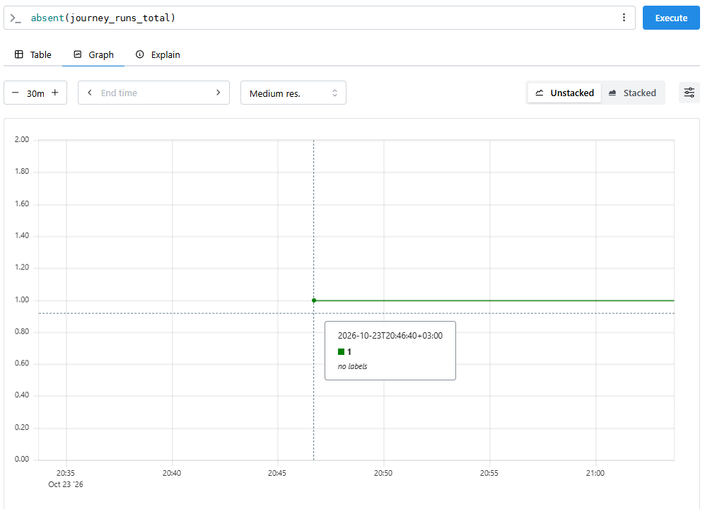
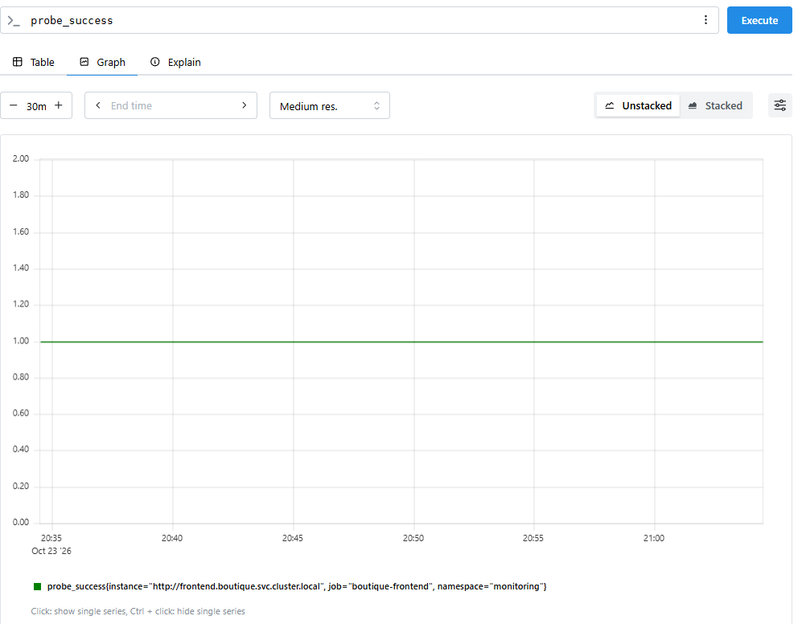

> График `absent(journey_runs_total)` показывает, что метрика `journey_runs_total` отсутствует в Prometheus. Это подтверждает, что journey-exporter остановлен и не отправляет данные. Мониторинг перестал получать данные о пользовательских сценариях, НО график `probe_success` не показывает никаких провалов или изменений, blackbox-проверка работает нормально.
> Мы теряем видимость проблем в пользовательском сценарии. Покупатель может сталкиваться с ошибками при оформлении заказа, но команда не получит алерт, потому что метрики не собираются. В продакшане это может привести к длительному простою, который останется незамеченным, пока не закончится error budget или не начнут поступать жалобы пользователей.

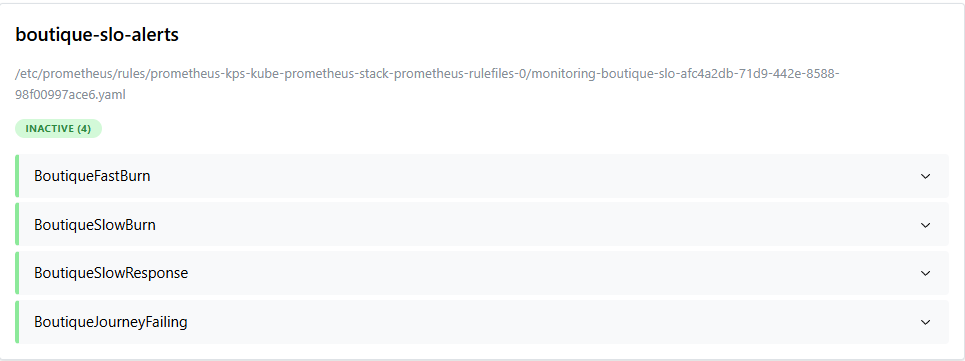

> Метрики синтетического мониторинга перестали поступать (journey-exporter упал), но существующие алерты по SLO (BoutiqueFastBurn, BoutiqueJourneyFailing) не сработали, потому что им не на чем основываться, тк данных нет
> Это "слепая зона": когда падает сам инструмент мониторинга, мы об этом не узнаем, пока не добавим специальный алерт на отсутствие данных.

### 4. Восстановить экспортер в **21:12:44 MSK**:
```bash
kubectl scale deploy/journey-exporter -n monitoring --replicas=1
```

### 5. Добавить алерт в `monitoring/slo-rules.yaml` (группа `boutique-slo-alerts`):
```yaml
- alert: JourneyExporterDown
  expr: absent(journey_runs_total)
  for: 2m
  labels:
    severity: warning
  annotations:
    summary: "journey-exporter не отдает метрики"
    description: "Синтетический мониторинг не работает, алерты по сценарию не сработают."
```

Применяем конфигурацию через следующую команду:
```bash
kubectl apply -f monitoring/slo-rules.yaml
```

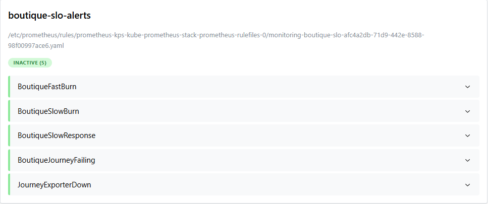

> Был добавлен новый алерт `JourneyExporterDown` - он будет показывать падения `journey-exporter` сервиса.

### 6. Прогон Б: повторить с отметкой времени **21:23:10 MSK**, дождаться алерта.
```bash
kubectl scale deploy/journey-exporter -n monitoring --replicas=0
```

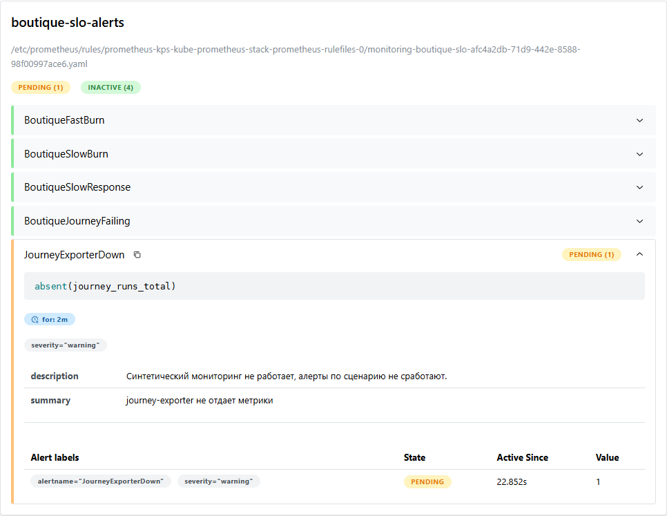
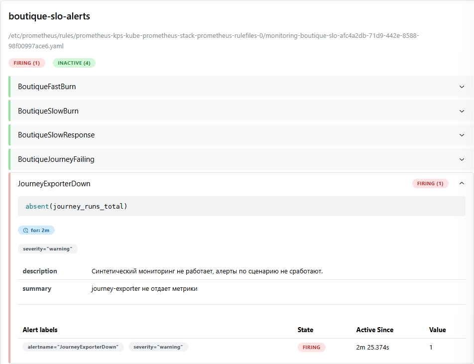


> Видно, что при прохождении 2 минут ожидания (for: 2m) алерт сразу перешел в состояние `FIRING`. Время `FIRING` по Prometheus: **21:25:43 MSK**. 

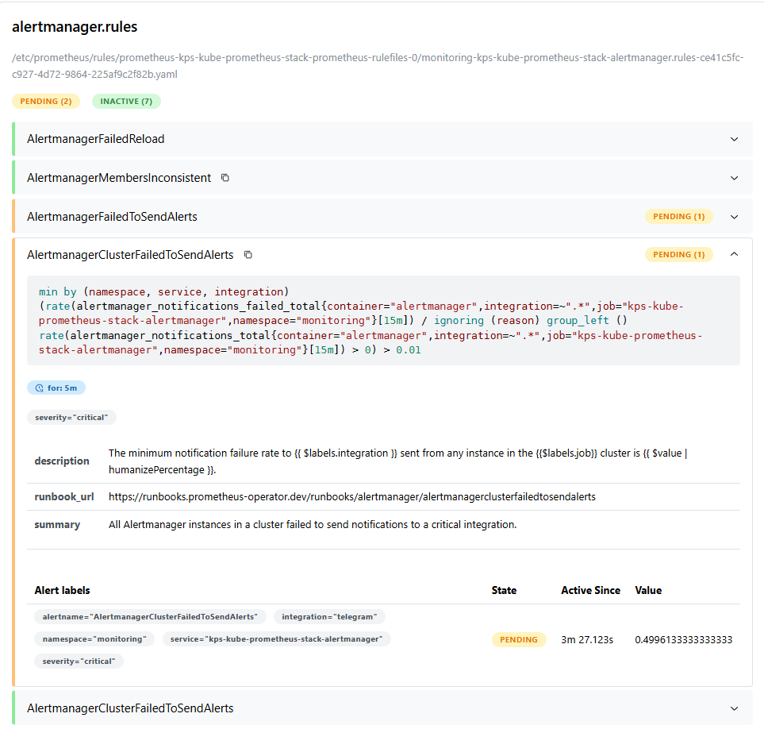
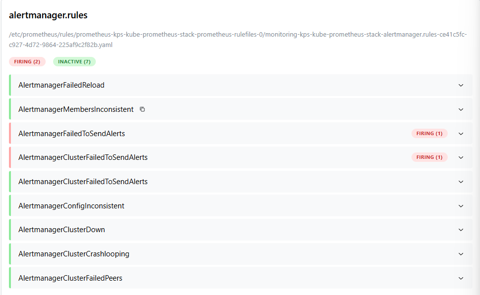

> В данном примере алерт менеджер завис и поэтому уведомления в Телеграмм пришло только в **21:39:58 MSK**. Исходя из логов, это произошло из-за того, что в проекте используется прокси Телеграмма из-за невозможности использовать официальный API. Для улучшения отправки алертов можно найти другой прокси и поправить конфигурацию. Для эксперимента это не помешало, но в реальной эксплуатации такая задержка недопустима.

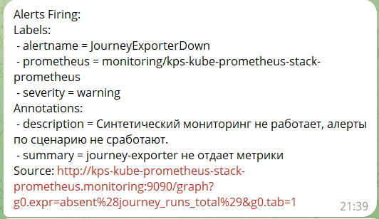
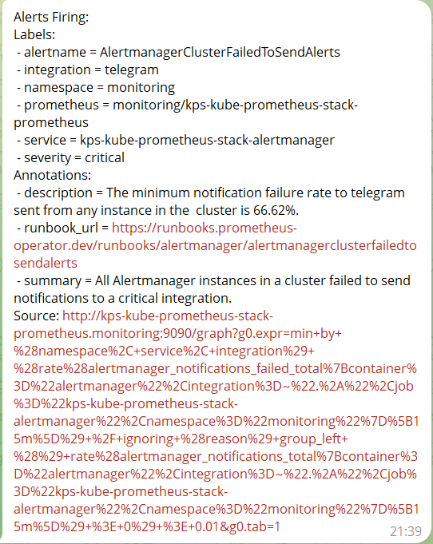


### 7. Восстановить экспортер и дождаться Resolved.
```bash
kubectl scale deploy/journey-exporter -n monitoring --replicas=1
```
Время восстановления: **21:46:44 MSK**. Время восстановления в Prometheus: **21:46:50 MSK**. Время восстановления в Телеграмм: **21:51:29 MSK**

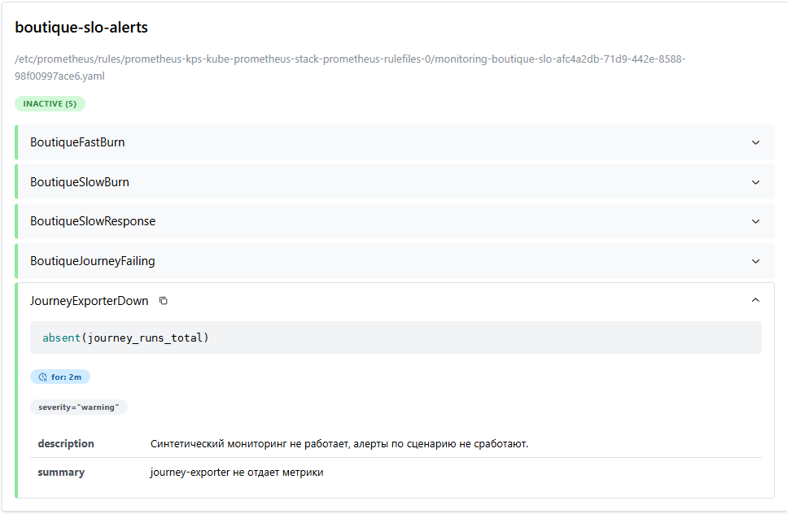

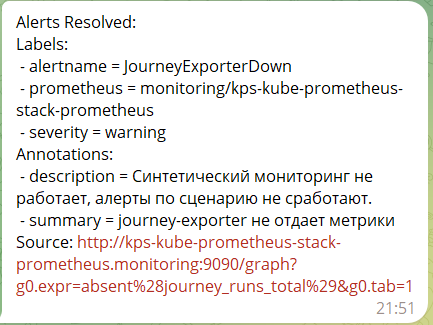


> В Prometheus алерт быстро восстановился, поскольку у него нет плавающего окна ожидания и он отрабатывает, когда проблема сразу же пропадает. В Телеграмм же уведомление пришло с большой задержкой.

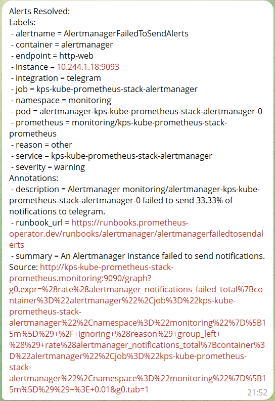
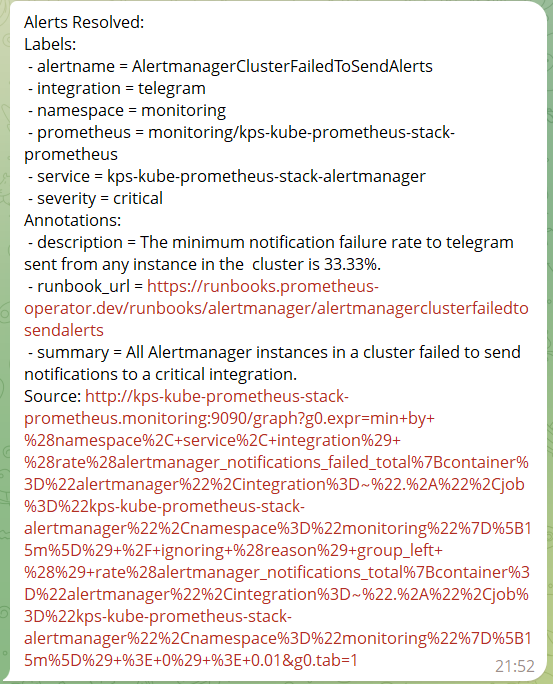

> Алерты `AlertmanagerFailedToSendAlerts` и `AlertmanagerClusterFailedToSendAlerts` спустя время тоже были решены.

----
## **Итоговое состояние метрик:**

### **Прогон А: витрина в порядке**
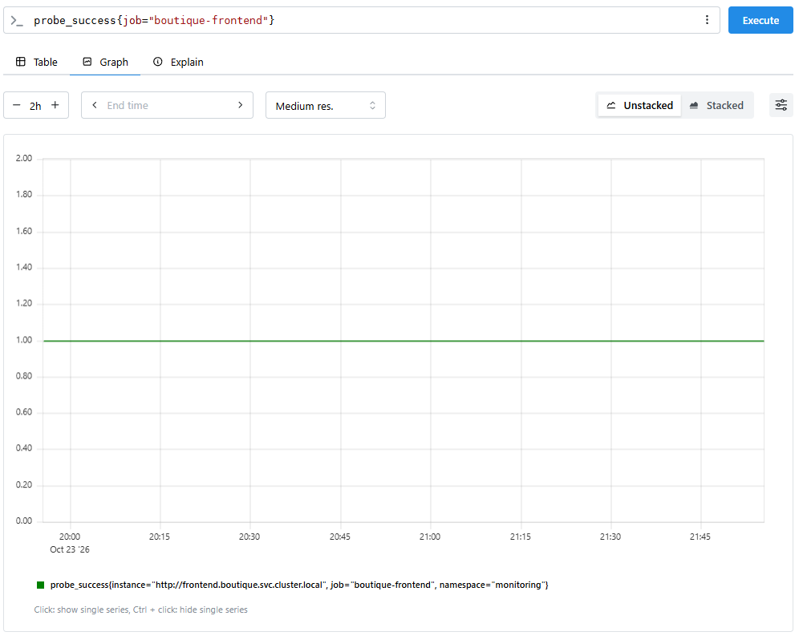


### **Прогон Б: алерт сработал**
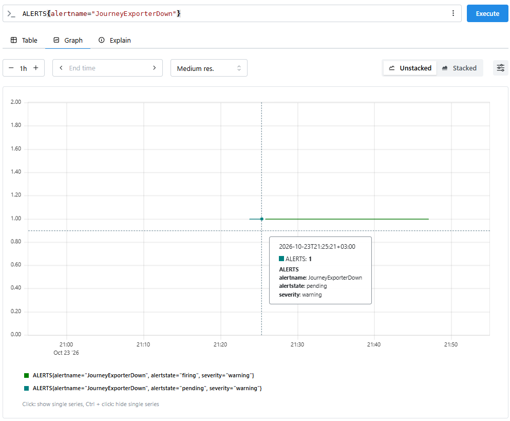


---
## **Ключевые SRE-метрики (TTD, TTR):**

| Метрика | Прогон А (до фикса) | Прогон Б (после фикса) | Комментарий |
|---|---|---|---|
| **Time to Detect (TTD)** | не обнаружено за 26 мин 42 сек | 2 мин 33 сек | `Прогон А:` с остановки (20:46:02) до восстановления (21:12:44) ни один алерт не сработал. `Прогон Б:` с остановки (21:23:10) до `FIRING` (21:25:43) |
| **Time to Notify** | не доставлено | 14 мин 15 сек | От `FIRING` (21:25:43) до сообщения в Телеграмм (21:39:58). Причина: проблемы с прокси Телеграмм (TLS handshake timeout) |
| **Time to Resolve (TTR)** | 26 мин 42 сек | 23 мин 34 сек | `Прогон А:` 20:46:02 → 21:12:44. `Прогон Б:` 21:23:10 → 21:46:44 |
| **Alert lag (Prometheus)** | n/a | 6 сек | От восстановления (21:46:44) до выхода из `FIRING` (21:46:50) |
| **Задержка Resolved (Телеграмм)** | n/a | 4 мин 39 сек | От выхода из `FIRING` (21:46:50) до уведомления Resolved (21:51:29) |

TTD не обнаружен для прогона А, поскольку метрика journey_runs_total исчезла из Prometheus в момент остановки journey-exporter, но ни один из существующих алертов (BoutiqueFastBurn, BoutiqueSlowBurn, BoutiqueJourneyFailing) не сработал, потому что их PromQL-выражения вычислялись по пустому вектору и возвращали "нет данных", а не "плохие данные".

После добавления алерта `JourneyExporterDown` с выражением `absent(journey_runs_total)` и параметром `for: 2m`, система обнаружила проблему через 2 минуты 33 секунды. Это время включает: ~30 сек на то, чтобы Prometheus заметил отсутствие метрики (следующий цикл scrape), 2 мин ожидания (параметр for: 2m) для исключения ложных срабатываний и ~3 сек на переход в статус `FIRING`. Следовательно, TTD для прогона Б = 2 мин 33 сек соответствует расчетному времени.

Time to Notify = 14 мин 15 сек: столько прошло от перехода алерта в `FIRING` (21:25:43) до сообщения в Телеграмм (21:39:58). Идеальное время < 1 минуты. Alertmanager отправляет сообщения через сторонний прокси (официальный Телеграмм API недоступен), прокси возвращал `TLS handshake timeout`, и Alertmanager повторял попытки. Система мониторинга обнаружила сбой вовремя, но доставка уведомления сильно деградировала.

---
## **Вывод:**
*Гипотеза подтвердилась.* Слепая зона реальна: исправление ее закрыло, но нашлась вторая слабость, в доставке уведомлений.

1. После остановки `journey-exporter` метрики `journey_*` пропали (`absent(journey_runs_total) = 1`). Существующие алерты (`BoutiqueFastBurn`, `BoutiqueSlowBurn`, `BoutiqueJourneyFailing`) не сработали: они считаются по пустому вектору и ничего не возвращают. Тишина не означала "все хорошо".
2. Blackbox и Kubernetes сбоя не показали: `probe_success = 1`, под `frontend` `Running 1/1`. Они наблюдают другие уровни системы, поэтому отказ самого синтетического мониторинга ими не покрывается.
3. В прогоне А мониторинг пользовательского пути был слеп **26 мин 42 сек**, и никто об этом не узнал бы. Если бы в это время упал `paymentservice` (эксперимент 3), сбой остался бы незамеченным.
4. Алерт `JourneyExporterDown` (`absent(journey_runs_total)`, `for: 2m`) исправил слепую зону: в прогоне Б `FIRING` наступил через 2 мин 33 сек, что совпало с расчетом (`for: 2m` плюс интервалы скрейпа и вычисления правил). Алерт гаснет в Prometheus почти сразу после восстановления (6 с), потому что у него нет скользящего окна.
5. Обнаружилась проблема **доставки уведомлений**: сообщение дошло через 14 мин 15 сек после `FIRING`. Сам Prometheus отработал вовремя, а задержку создал канал до Телеграмм (нестабильный прокси, повторы отправки). Алерты `AlertmanagerFailedToSendAlerts` и `AlertmanagerClusterFailedToSendAlerts` сработали, но предупреждение о неработающей доставке не может прийти по той же неработающей доставке.

Получается, что время от сбоя до реального сообщения составило около 16 минут (2:33 обнаружения плюс 14:15 доставки). Для предупреждающего (`warning`) алерта это допустимо, для критичного нет. Эксперимент показал, что надежность мониторинга определяется не только правилами в Prometheus, но и всей цепочкой до человека.

---
## **Что можно улучшить**

- [ ] **Надежный канал доставки.** Заменить нестабильный прокси на другой (или развернуть собственный relay) и добавить второй независимый канал (email или Slack), чтобы один сбой не отрезал дежурного от уведомлений. Цель: Time to Notify < 1 минуты.
- [ ] **Watchdog (dead man's switch).** Постоянно активный алерт `Watchdog`, который отправляется во внешний сервис (например, Healthchecks.io). Если сообщения перестанут приходить, внешний сервис сам поднимет тревогу. Это единственный способ узнать, что сломан весь канал алертинга, включая сам Alertmanager.
- [ ] **Алерты на отсутствие данных для остальных источников.** `absent(probe_success{job="boutique-frontend"})` и `absent(kube_pod_status_ready)`. Принцип один: любой источник, на котором держатся алерты, нужно сторожить.
- [ ] **Различать «упал» и «исчез».** `absent(...)` ловит пропажу серии (в том числе масштабирование до 0 реплик), а `up{job="journey-exporter"} == 0` ловит случай, когда цель есть, но не отвечает на скрейп. Для полного покрытия нужны оба.
- [ ] **Отказоустойчивость самого экспортера.** Запускать `journey-exporter` в двух репликах или хотя бы настроить `livenessProbe` и быстрый перезапуск, чтобы однократный сбой не создавал окно слепоты.
- [ ] **Правильная маршрутизация.** Алерты о сбое самой системы наблюдаемости (`JourneyExporterDown`, `AlertmanagerFailedToSendAlerts`) стоит направлять отдельным каналом, а не в общий поток с инцидентами продукта.


---
## **Связанные документы**

- **Runbook:** …
- **SLO:** [`docs/slo.md`](/docs/slo.md) - SLO-1 (доступность витрины)
- **Алерты:** `monitoring/slo-rules.yaml` -> группа `boutique-slo-alerts`
- **Эксперимент 1:** [`2026-10-19-incident-frontend-down.md`](/chaos/2026-10-19/2026-10-19-incident-frontend-down.md)
- **Эксперимент 2:** [`2026-10-21-incident-cartservice-down-frontend-up.md`](/chaos/2026-10-21/2026-10-21-incident-cartservice-down-frontend-up.md)
- **Эксперимент 3:** [`2026-10-22-incident.md`](/chaos/2026-10-22/2026-10-22-incident.md)
