# Хаос-эксперимент 5: Плохой деплой, ImagePullBackOff, пользователь не страдает
**Дата:** 24 октября 2026 (суббота)

**Серьезность:** P4 / Low (пользователи не замечают проблем, но инфраструктура в деградированном состоянии)

**Сервис:** `frontend`

**Алерт:** до исправления алертов нет; после исправления `K8sDeploymentStuck`

-----
## **Цель:**

Проверить поведение системы при выкатке несуществующего образа. Убедиться, что стратегия Rolling Update сохраняет работоспособность старого пода, но при этом зафиксировать, что существующие SLO-алерты не видят эту проблему, так как пользовательский трафик обрабатывается корректно.


----
## **Гипотеза:**
Прогон А (до исправления). Если задать несуществующий тег образа для frontend, то:
1. Новый под уйдет в статус `ImagePullBackOff` или `ErrImagePull`.
2. Старый под останется в статусе `Running 1/1` и продолжит обслуживать трафик (благодаря `maxUnavailable=0` при 1 реплике).
3. `probe_success` останется равным 1, пользователь ничего не заметит.
4. Ни один из бизнес-алертов (`BoutiqueFastBurn`, `BoutiqueJourneyFailing`) не сработает.
5. Сбой увидит только метрика состояния Kubernetes (`kube_pod_container_status_waiting_reason`).

Прогон Б (после исправления). После добавления алерта на недоступные реплики (kube_deployment_status_replicas_unavailable > 0, for: 5m):
6. Тот же сбой приведет к `FIRING` примерно через 5 минут, и уведомление придет в Телеграмм.


----
## **Действия:**
### 1. Прогон А: зафиксировать время начала: **00:22:59 MSK**.

### 2. Инициируем плохой деплой.
```bash
kubectl set image deploy/frontend server=gcr.io/google-samples/microservices-demo/frontend:no-such-tag -n boutique
```

### 3. Наблюдать за метриками в Prometheus.

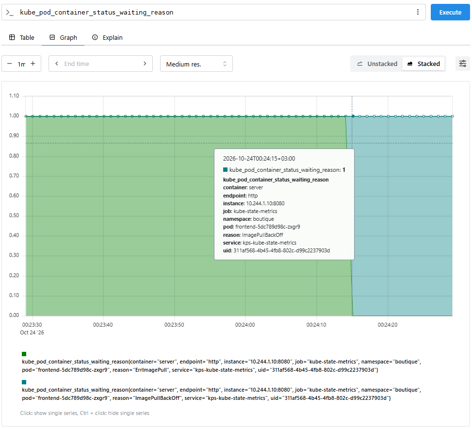

> Метрика `kube_pod_container_status_waiting_reason{reason="ImagePullBackOff", namespace="boutique", deployment="frontend"}` выросла до 1. Kubernetes видит проблему с развертыванием нового пода.


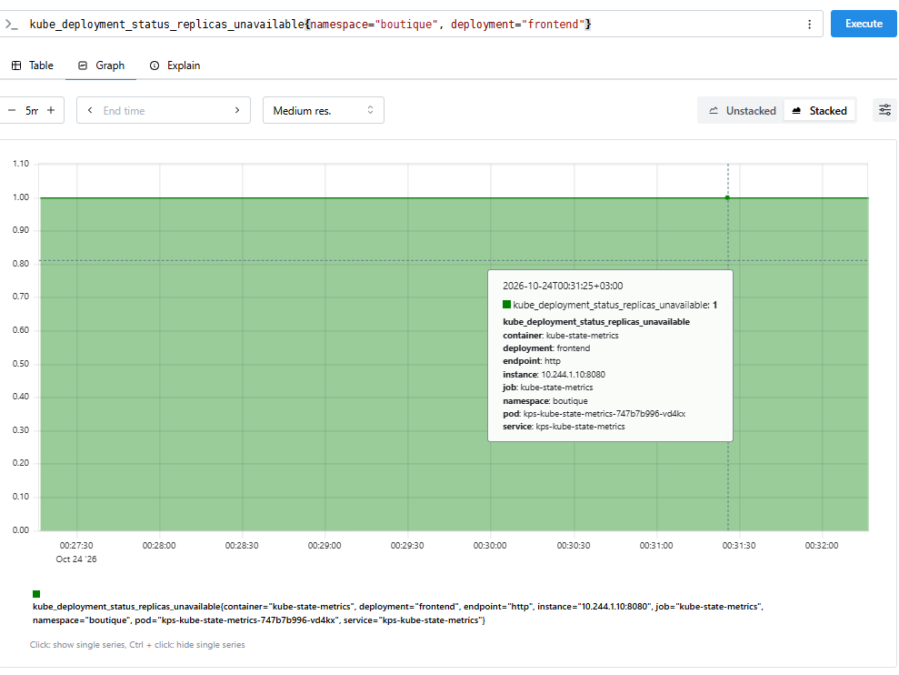

> Значение 1 на всем интервале эксперимента показывает, что `Deployment frontend` имеет 1 недоступную реплику. Это происходит потому что rolling update не может завершиться: новый под с образом no-such-tag не запускается, а старый под хотя и обслуживает трафик, но Kubernetes считает обновление "незавершенным".


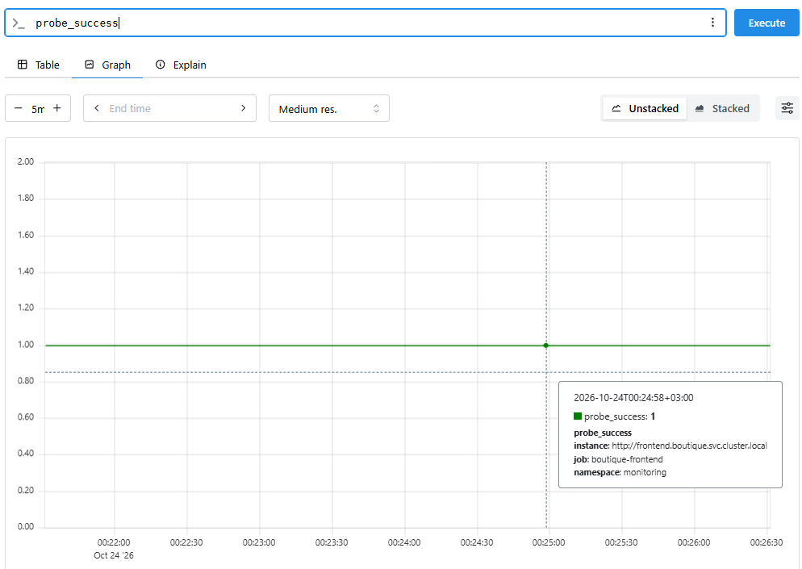
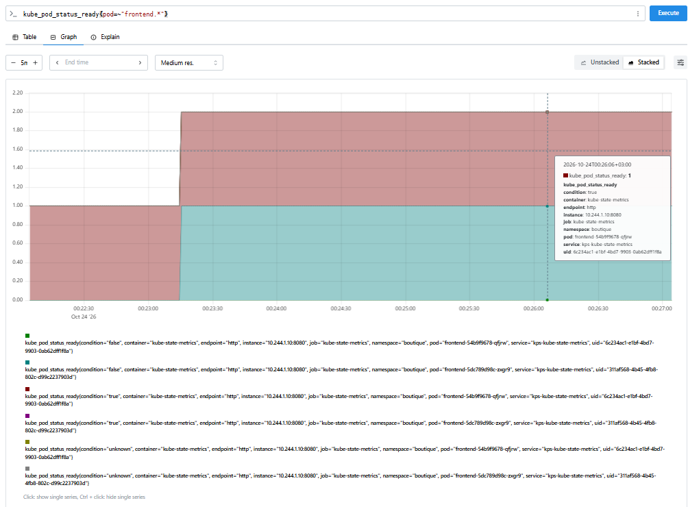

> `probe_success = 1` и `kube_pod_status_ready{pod=~"frontend.*"} = 1`. Старый под продолжает работать, blackbox не видит ошибок. Пользовательский опыт не деградировал.


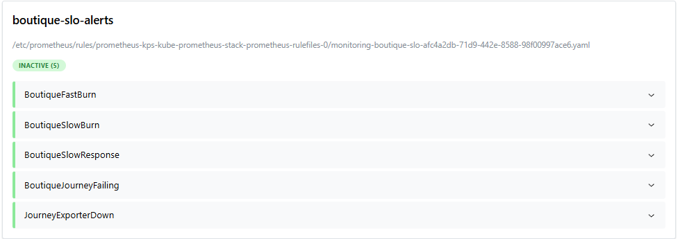

> Все SLO-алерты (`BoutiqueFastBurn`, `BoutiqueJourneyFailing`) остаются в статусе `INACTIVE`. Система мониторинга бизнеса "молчит", хотя деплой застрял.


### 4. Восстановить деплой в **00:37:09 MSK**:
```bash
kubectl rollout undo deploy/frontend -n boutique
```

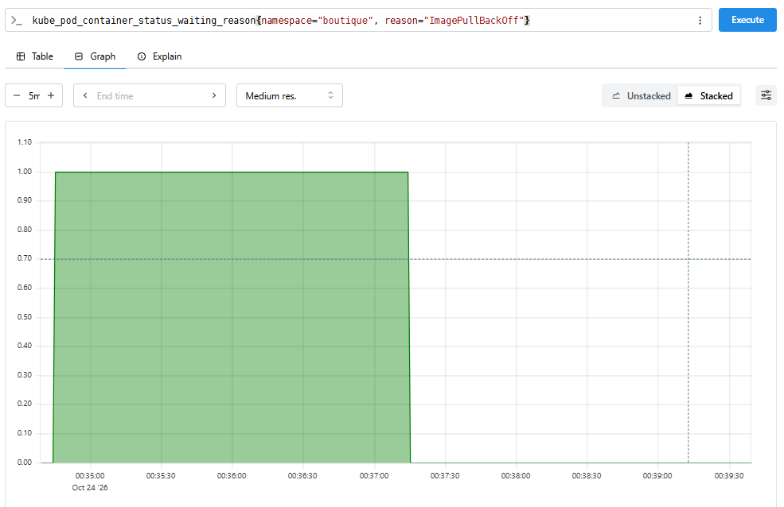

> Значение упало до 0 сразу после выполнения rollout undo (00:37:09). `Deployment frontend` завершил откат к рабочей версии, все реплики снова доступны. Инфраструктурная метрика показывает, что обновление больше не "застряло".

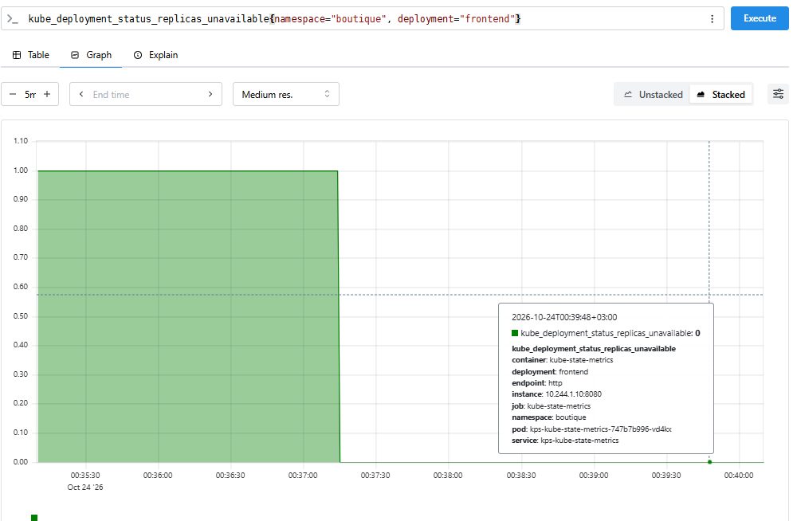

> Метрика также вернулась к 0 - под с битым образом (no-such-tag) был удален, новый под с рабочим образом успешно запустился. Проблема на уровне контейнера устранена.

> Оба графика подтверждают, что откат деплоя прошел успешно. Kubernetes автоматически восстановил желаемое состояние: старый рабочий образ снова обслуживает трафик, инфраструктурные метрики в норме.

### 5. Добавить алерт в `monitoring/slo-rules.yaml` (группа `boutique-slo-alerts`):
```yaml
- alert: K8sDeploymentStuck
  expr: kube_deployment_status_replicas_unavailable{namespace="boutique"} > 0
  for: 5m
  labels:
    severity: warning
  annotations:
    summary: "Деплой {{ $labels.deployment }} застрял"
    description: "Недоступные реплики: {{ $value }}. Проверьте ImagePullBackOff, OOMKilled или CrashLoopBackOff."
```

Применяем конфигурацию через следующую команду:
```bash
kubectl apply -f monitoring/slo-rules.yaml
```

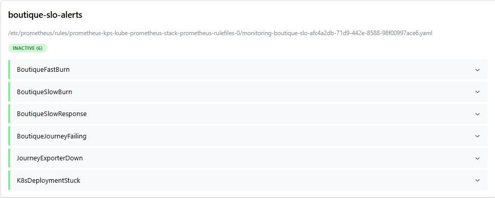

> Был добавлен новый алерт `K8sDeploymentStuck` - он будет показывать проблемы на уровне оркестрации, даже если пользовательский трафик не страдает.

### 6. Прогон Б: повторить с отметкой времени **00:46:01 MSK**, дождаться алерта.
```bash
kubectl set image deploy/frontend server=gcr.io/google-samples/microservices-demo/frontend:no-such-tag -n boutique
```

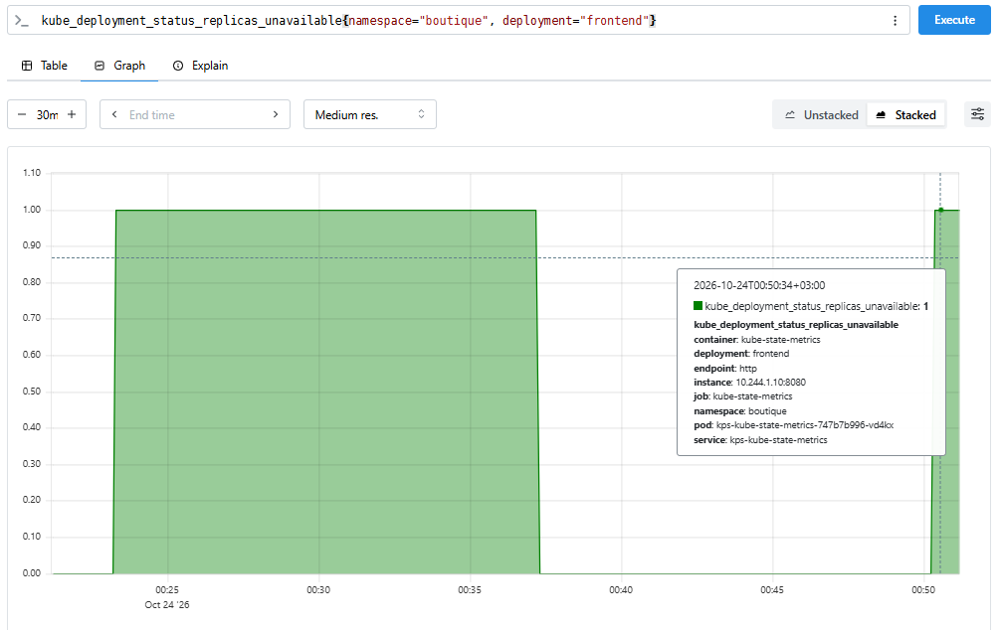

> Метрика `kube_deployment_status_replicas_unavailable{namespace="boutique", deployment="frontend"}` аналогично выросла до **1** сразу после обновления образа (00:46:01). Алерт `K8sDeploymentStuck` зафиксирует эту проблему.


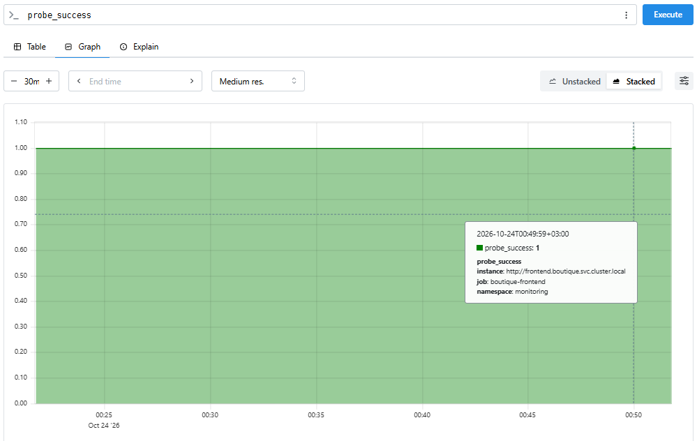

> Метрика `probe_success = 1` на протяжении всего эксперимента. Blackbox-exporter продолжает успешно проверять главную страницу витрины. Старый под frontend работает корректно и обслуживает трафик, пока новый под не может запуститься. Пользовательский опыт не деградировал - это ожидаемое поведение Rolling Update в Kubernetes.


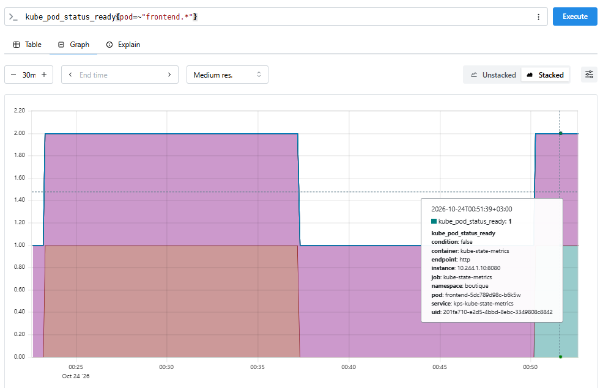

> Метрика `kube_pod_status_ready{pod=~"frontend.*"}` показывает изменение состояния подов frontend. 


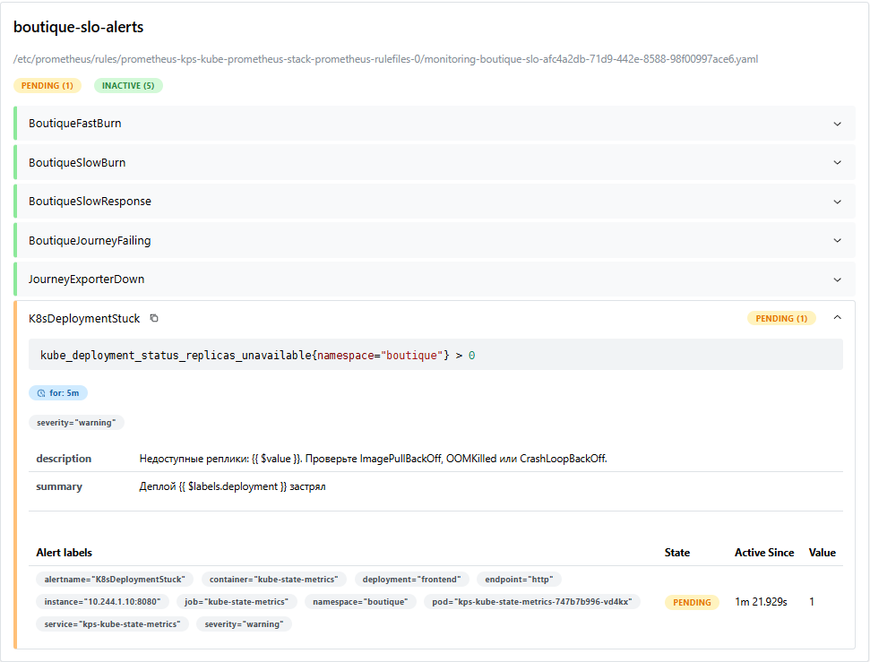
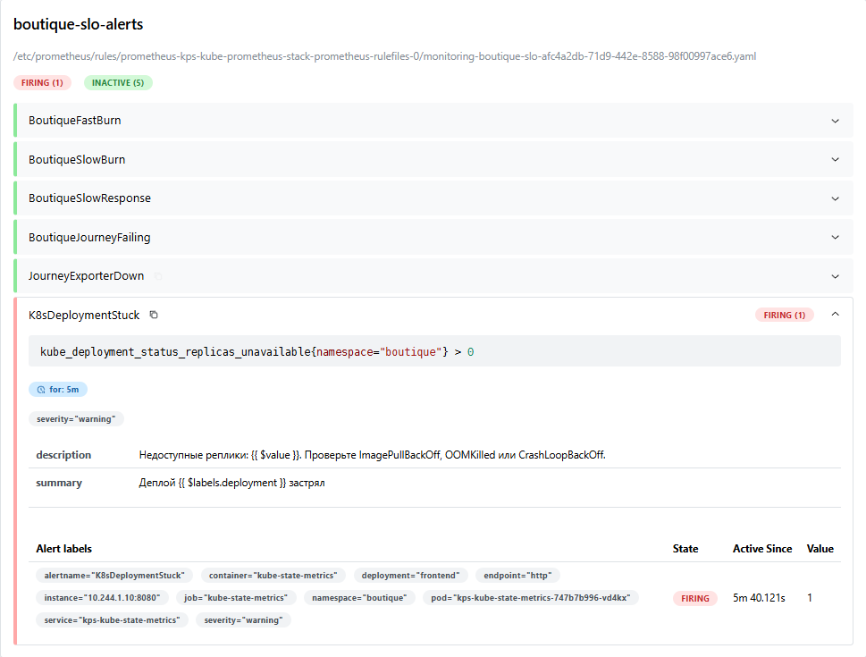

> Видно, что при прохождении 5 минут ожидания (`for: 5m`) алерт перешел в состояние `FIRING`. Время `FIRING` по Prometheus: **00:51:31 MSK**.

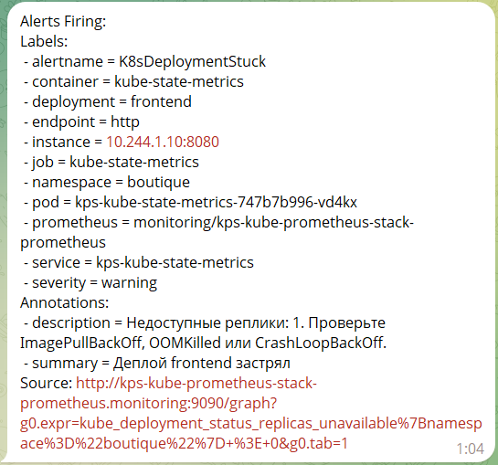

> Уведомление в Телеграмм пришло в **01:04:52 MSK**. Снова произошел сбой в `AlertmanagerFailedToSendAlerts` и `AlertmanagerClusterFailedToSendAlerts`, поэтому уведомление задержалось. Подробнее эта проблема описана в эксперименте 3.


Во время эксперимента также сработал стандартный алерт из пакета `kube-prometheus-stack`: `KubePodNotReady`.

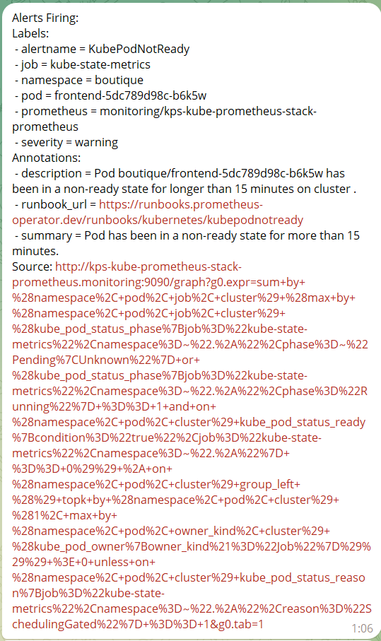

> Хотя `KubePodNotReady` успешно зафиксировал проблему, у него есть два существенных ограничения для данного сценария:
> 1. **Время реакции (15 минут):** Стандартное правило ждет 15 минут, прежде чем поднять тревогу. Для "застрявшего" деплоя это слишком долго. Наш кастомный алерт `K8sDeploymentStuck` с параметром `for: 5m` обнаруживает ту же проблему в 3 раза быстрее.
> 2. **Уровень абстракции:** `KubePodNotReady` указывает на конкретный под с длинным случайным именем. Дежурному инженеру нужно дополнительно сопоставлять этот под с Deployment'ом. Алерт `K8sDeploymentStuck` сразу говорит о проблеме на уровне `Deployment` (`replicas_unavailable`), что напрямую указывает на сбой процесса обновления (Rolling Update).


### 7. Восстановить деплой и дождаться Resolved.
```bash
kubectl rollout undo deploy/frontend -n boutique
```
Время восстановления: **01:11:38 MSK**. Время восстановления в Prometheus: **01:12:10 MSK**. Время восстановления в Телеграмм: **01:17:15 MSK**

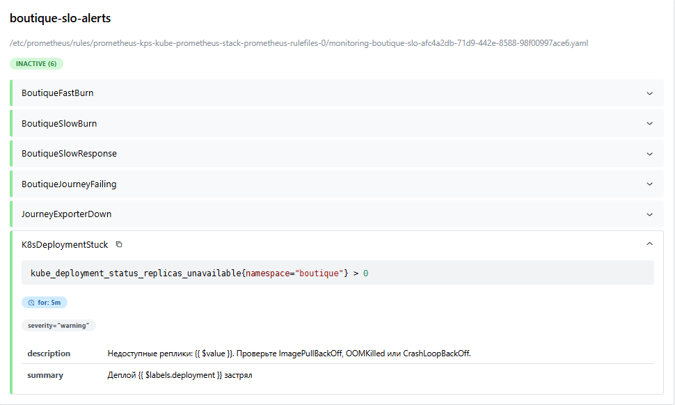
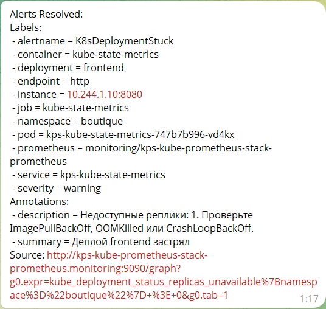

> В Prometheus алерт быстро восстановился, поскольку у него нет плавающего окна ожидания и он отрабатывает, когда проблема сразу же пропадает. В Телеграмм же уведомление пришло с большой задержкой.


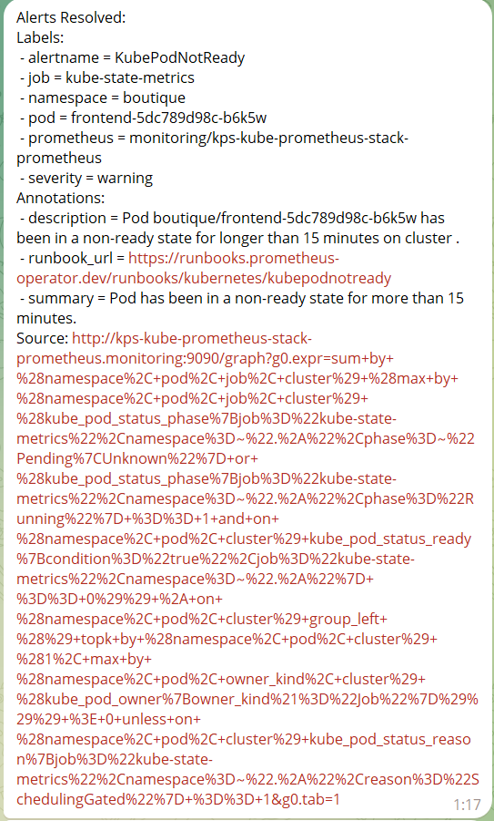
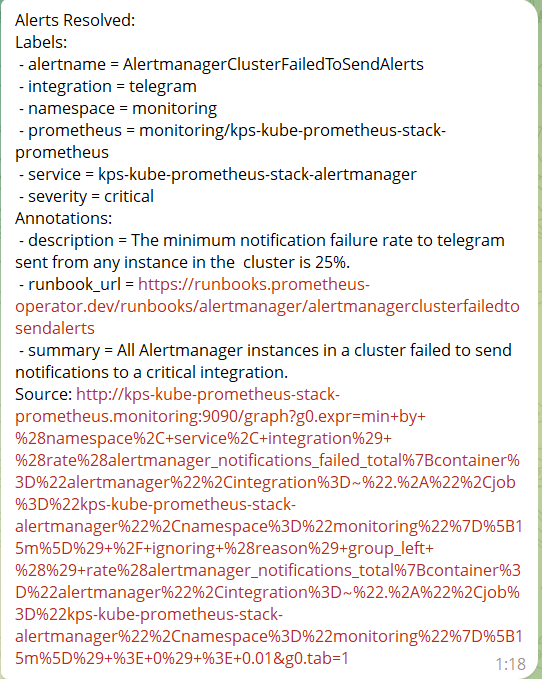
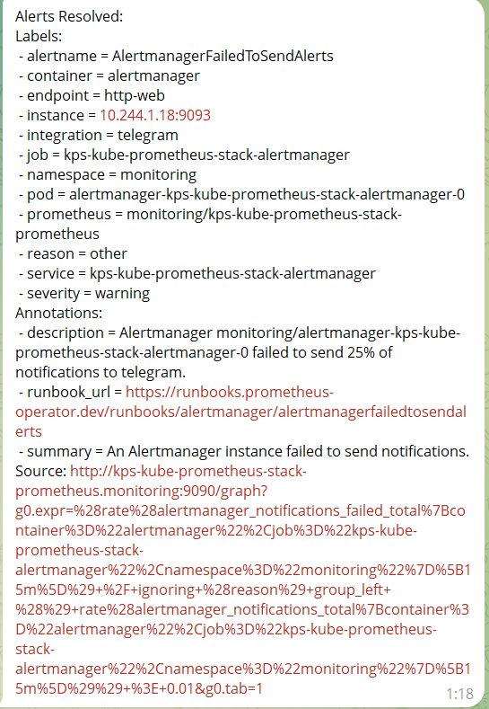

> Алерты `KubePodNotReady`, `AlertmanagerFailedToSendAlerts`, `AlertmanagerClusterFailedToSendAlerts` спустя время тоже были решены.

---
## **Ключевые SRE-метрики (TTD, TTR):**

| Метрика | Прогон А (до фикса) | Прогон Б (после фикса) | Комментарий |
|---|---|---|---|
| **Time to Detect (TTD)** | не обнаружено | 5 мин 30 сек | `Прогон А:` с начала деплоя (00:22:59) до отката (00:37:09) `BoutiqueFastBurn` и `BoutiqueJourneyFailing` молчали. `Прогон Б:` с начала деплоя (00:46:01) до `FIRING` `K8sDeploymentStuck` (00:51:31) |
| **Time to Notify** | не доставлено | 13 мин 21 сек | От `FIRING` (00:51:31) до сообщения в Телеграмм (01:04:52) из-за сбоя отправки в Alertmanager (`AlertmanagerFailedToSendAlerts`) |
| **От сбоя до сообщения дежурному** | никогда | 18 мин 51 сек | 00:46:01 → 01:04:52 |
| **Alert lag (Prometheus)** | n/a | 32 сек | От отката (01:11:38) до выхода из `FIRING` (01:12:10) |
| **Задержка Resolved (Телеграмм)** | n/a | 5 мин 5 сек | От выхода из `FIRING` (01:12:10) до уведомления Resolved (01:17:15) |

В прогоне А ни один бизнес-алерт не сработал: пользовательский трафик обслуживал старый под, `probe_success` оставался равным 1. Сбой был виден только в метриках состояния Kubernetes (`kube_pod_container_status_waiting_reason`, `kube_deployment_status_replicas_unavailable`), на которые не было ни одного алерта.

В прогоне Б алерт `K8sDeploymentStuck` (`kube_deployment_status_replicas_unavailable > 0`, `for: 5m`) перешел в `FIRING` через **5 мин 30 сек**, что близко к расчетным ~5 минутам. Небольшое превышение объясняется временем на создание пода, переход в `ImagePullBackOff` и следующий цикл scrape метрики `kube-state-metrics`.

Time to Notify составил **13 мин 21 сек**: в этот период снова сработали `AlertmanagerFailedToSendAlerts` и `AlertmanagerClusterFailedToSendAlerts`, причина та же, что в эксперименте 4 (нестабильный прокси Телеграмм). Уведомление `Resolved` пришло через 5 минут 5 секунд после выхода алерта из `FIRING`.

---
## **Вывод:**
*Гипотеза подтвердилась.* 

1. После выкатки несуществующего образа новый под ушел в `ImagePullBackOff`, а старый остался `Running 1/1` и продолжил обслуживать трафик: стратегия Rolling Update не убирает рабочий под, пока новый не станет `Ready`. Пользователь сбоя не заметил (`probe_success = 1`, `kube_pod_status_ready = 1`).
2. Бизнес-алерты (`BoutiqueFastBurn`, `BoutiqueJourneyFailing`) молчали все 14 мин 10 сек прогона А. Это правильное поведение для SLO-алертов: пользователи не страдают. Но молчание не означает, что все в порядке: деплой застрял, система работала без запаса отказоустойчивости (одна живая реплика, обновление не завершено), а новая версия в продакшн не попала.
3. Сбой видели только метрики Kubernetes: `kube_pod_container_status_waiting_reason{reason="ImagePullBackOff"} = 1` и `kube_deployment_status_replicas_unavailable = 1`. До добавления алерта они никого не уведомляли.
4. Алерт `K8sDeploymentStuck` закрыл эту слепую зону: в прогоне Б он перешел в `FIRING` через 5 мин 30 сек, что идеально совпало с расчетным временем (5 минут `for`, время на создание пода и переход в `ImagePullBackOff`). Он работает на уровне `Deployment` и говорит именно о застрявшем обновлении, в отличие от стандартного `KubePodNotReady`, который указывает на конкретный под со случайным именем и по умолчанию ждет 15 минут.
5. Уведомление дошло через 13 мин 21 сек после `FIRING`: доставка снова деградировала (`AlertmanagerFailedToSendAlerts`), подробнее в эксперименте 4. От начала деплоя до сообщения дежурному прошло 18 мин 51 сек. Для статуса `warning` на не пострадавшем сервисе это терпимо, но показывает, что проблема канала доставки повторяется и требует отдельного исправления.
6. После `rollout undo` метрики вернулись к норме за секунды, алерт вышел из `FIRING` через 32 секунды.

Не каждый сбой виден пользователю, и мониторинг должен различать "пользователь страдает" (бизнес-алерты, критичный уровень) и "система деградировала, но пока держится" (инфраструктурные алерты, предупреждающий уровень).

---
## **Что можно улучшить**

- [ ] **Алерт на сам факт застрявшего деплоя.** Дополнить `K8sDeploymentStuck` проверкой `kube_deployment_status_condition{condition="Progressing", status="false"}`: Kubernetes сам помечает деплой как неуспешный по истечении `progressDeadlineSeconds` (по умолчанию 600 секунд), и это более прямой сигнал, чем недоступные реплики.
- [ ] **Алерт на причину.** `kube_pod_container_status_waiting_reason{reason=~"ImagePullBackOff|ErrImagePull|CrashLoopBackOff"} > 0` с уровнем `warning`. Он дает дежурному диагноз сразу, а не после проверки пода.
- [ ] **Проверка выкатки в процессе деплоя.** Запускать `kubectl rollout status --timeout=...` и откатывать автоматически при неудаче (`kubectl rollout undo`), чтобы застрявший деплой не висел до ручного вмешательства.
- [ ] **Проверка образа до выкатки.** Валидация существования тега в registry в CI и использование закрепленных тегов или digest вместо `latest`, чтобы несуществующий образ не доходил до кластера.
- [ ] **Две реплики `frontend`.** При одной реплике застрявший деплой оставляет систему с единственным подом без запаса. С двумя репликами то же самое обновление оставило бы запас отказоустойчивости.
- [ ] **Надежная доставка уведомлений.** Проблему канала до Телеграмм (прокси) нужно закрыть до расширения набора алертов, иначе новые алерты будут доходить с задержкой в 9-14 минут. Подробнее: эксперимент 4.


---
## **Связанные документы**

- **Runbook:** [deployment-stuck.md](/docs/runbooks/deployment-stuck.md)
- **SLO:** [`docs/slo.md`](/docs/slo.md) - SLO-1 (доступность витрины)
- **Алерты:** `monitoring/slo-rules.yaml` -> группа `boutique-slo-alerts`
- **Эксперимент 1:** [`2026-10-19-incident-frontend-down.md`](/chaos/2026-10-19/2026-10-19-incident-frontend-down.md)
- **Эксперимент 2:** [`2026-10-21-incident-cartservice-down-frontend-up.md`](/chaos/2026-10-21/2026-10-21-incident-cartservice-down-frontend-up.md)
- **Эксперимент 3:** [`2026-10-22-incident.md`](/chaos/2026-10-22/2026-10-22-incident.md)
- **Эксперимент 4:** [`2026-10-23-incident-journey-exporter-down.md`](/chaos/2026-10-23/2026-10-23-incident-journey-exporter-down.md)
