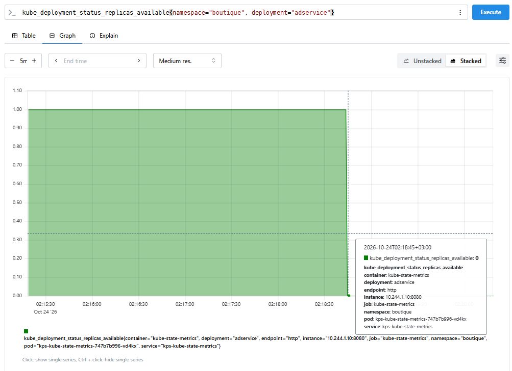
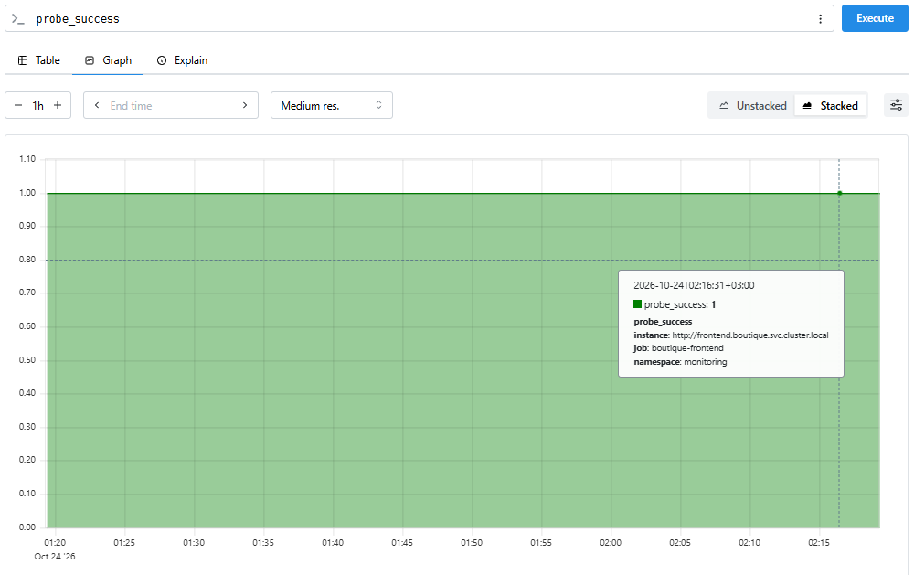
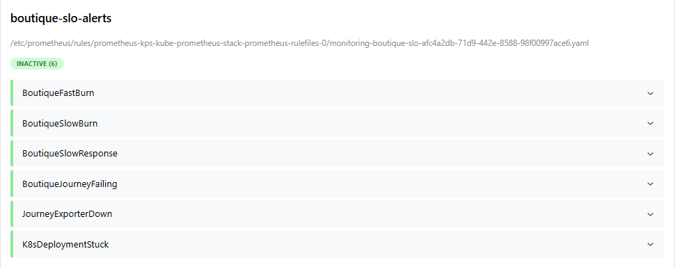
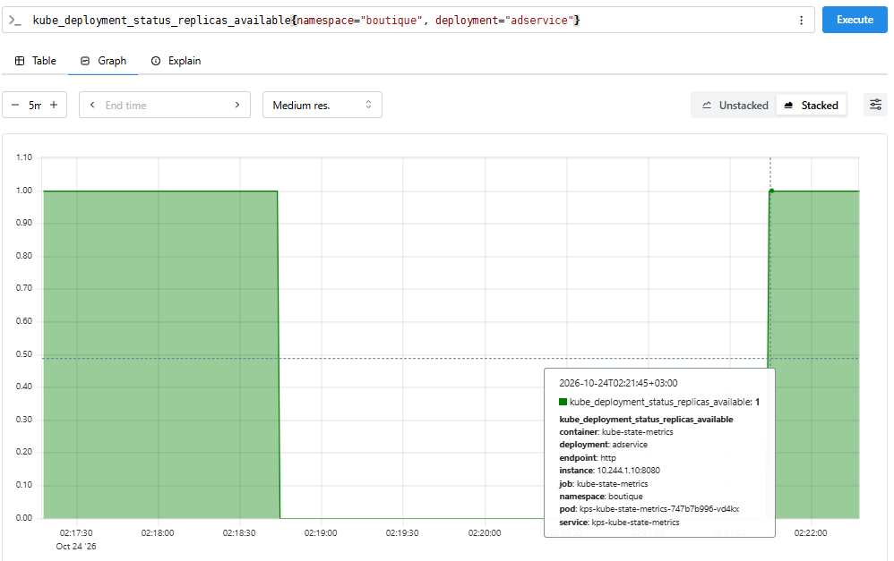
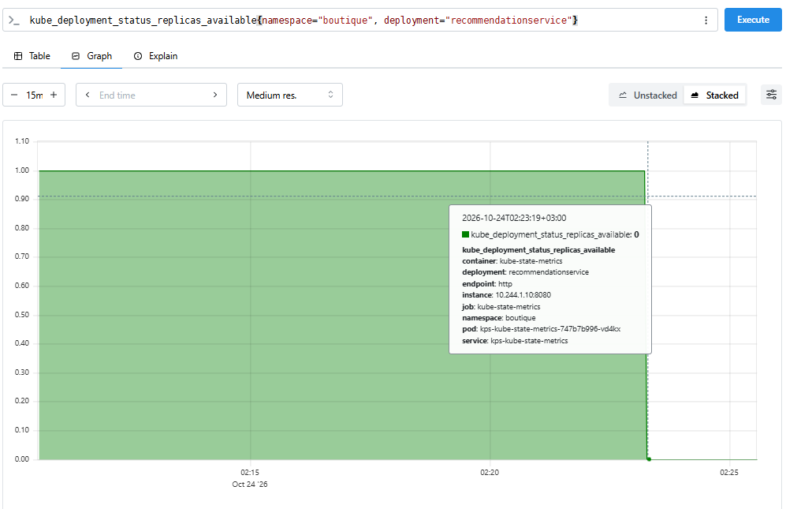
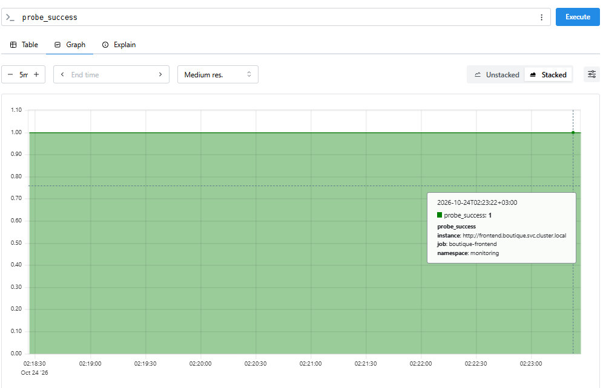
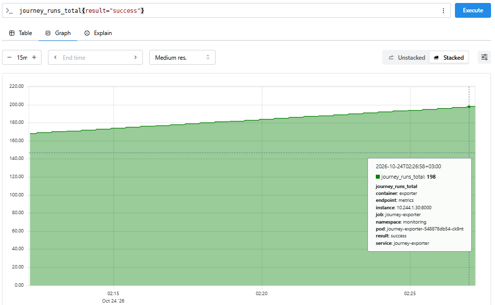
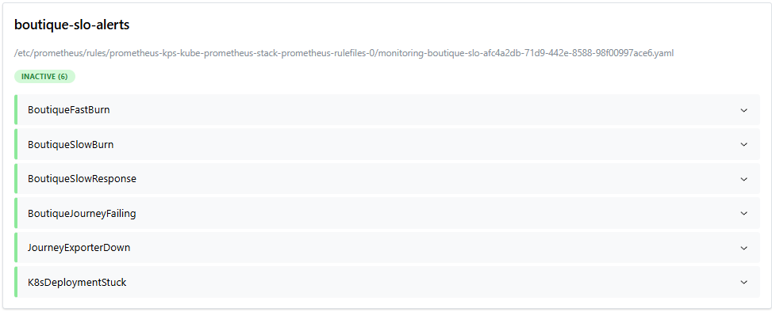
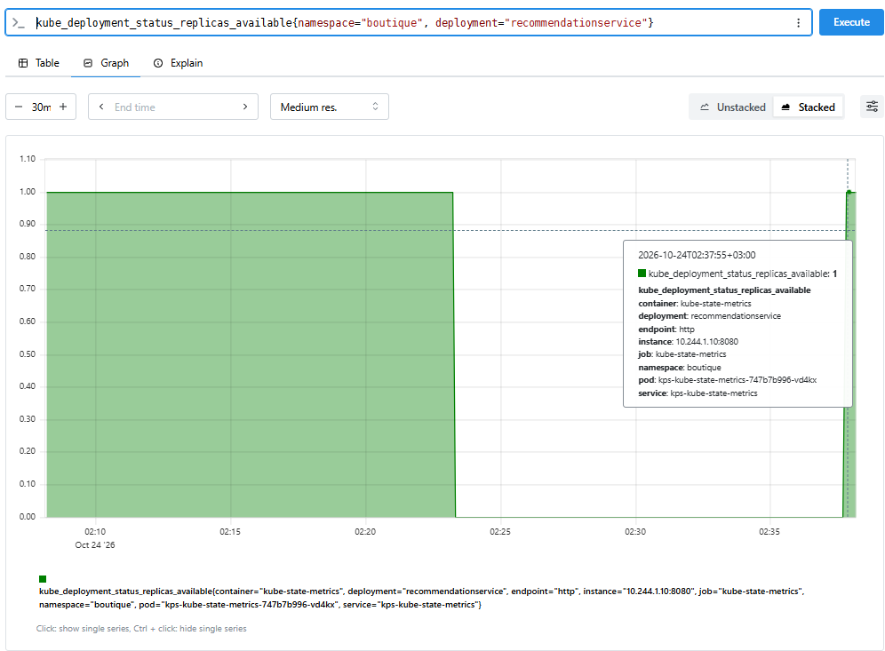

# Хаос-эксперимент 6: Отказ некритичной зависимости, Graceful Degradation
**Дата:** 24 октября 2026 (суббота)

**Серьезность:** P4 / Low (ожидаемое поведение системы, пользователи не страдают)

**Сервис:**  `adservice` (Прогон А), `recommendationservice` (Прогон Б)

**Алерт:**  отсутствует.

-----
## **Цель:**

Проверить, что отказ второстепенного сервиса не приводит к каскадному падению всей витрины. Убедиться, что реализован паттерн Graceful Degradation (элегантная деградация), и система продолжает обслуживать основной пользовательский сценарий. Сравнить поведение с Экспериментом 2, где отказ `cartservice` приводил к полному отказу главной страницы (HTTP 500).

----
## **Гипотеза:**
Прогон А (`adservice`). Если масштабировать `adservice` до 0 реплик, то:
1. Главная страница (`/`) и страница товара (`/product/...`) продолжат отдавать HTTP 200.
2. `probe_success` останется равным 1 (blackbox проверяет главную страницу).
3. `journey_runs_total{result="success"}` будет расти, синтетический сценарий проходит целиком, игнорируя отсутствие рекламы.
4. Ни один алерт (`BoutiqueFastBurn`, `BoutiqueJourneyFailing`) не сработает.
5. Единственный след в мониторинге: `kube_deployment_status_replicas_available{deployment="adservice"} = 0`.

Прогон Б (`recommendationservice`). Если масштабировать `recommendationservice` до 0 реплик:
1. Главная страница (`/`) продолжит отдавать HTTP 200 (`probe_success = 1`).
2. Страница товара (`/product/...`) может начать отдавать HTTP 500 (зависит от реализации обработки ошибок во `frontend`).
3. Если это так, `journey_step_failures_total{step="product"}` начнет расти, и сработает `BoutiqueJourneyFailing`.
4. Это покажет, что сервис, названный "некритичным", на самом деле является жесткой зависимостью для части пользовательского пути.


----
## **Действия:**
### 1. Прогон А: зафиксировать время начала: **02:18:16 MSK**.

### 2. Остановим сервис adservice.
```bash
kubectl scale deploy/adservice -n boutique --replicas=0
```

### 3. Наблюдать за метриками в Prometheus.



> `kube_deployment_status_replicas_available{namespace="boutique", deployment="adservice"}` упал до 0. Kubernetes зафиксировал отсутствие доступных реплик.




> `probe_success = 1`. Blackbox успешно получает HTTP 200. Метрика `journey_runs_total{result="success"}` продолжает расти. Сценарий покупки не прерывается, так как `frontend` корректно обрабатывает отсутствие блока рекламы.




> Все алерты остаются в статусе `INACTIVE`. Это корректное поведение: нет нарушения SLO, нет основания для тревоги.

### 4. Восстановить сервис рекламы в **02:21:05 MSK**:
```bash
kubectl scale deploy/adservice -n boutique --replicas=1
```



> `kube_deployment_status_replicas_available{namespace="boutique", deployment="adservice"}` вернулась к 1. Kubernetes успешно создал новый под, и сервис снова доступен. Поскольку во время эксперимента пользовательские метрики (`probe_success`, `journey_runs_total`) не падали, никаких алертов гасить не потребовалось.

### 5. Прогон Б: зафиксировать время начала: **02:23:03 MSK**.
```bash
kubectl scale deploy/recommendationservice -n boutique --replicas=0
```

### 6. Наблюдать за метриками в Prometheus.



> `kube_deployment_status_replicas_available{namespace="boutique", deployment="recommendationservice"}` упал до 0. Kubernetes зафиксировал отсутствие доступных реплик.





> `probe_success` остался равен 1 (главная работает), и `journey_runs_total{result="success"}` продолжает линейно расти (с 167 до 198 за ~7 минут).
>
> Это означает, что `frontend` обрабатывает отсутствие `recommendationservice` **gracefully** - страница товара продолжает работать (HTTP 200), просто без блока рекомендаций. Синтетический сценарий проходит успешно, алерты не срабатывают.



> Все алерты остаются в статусе `INACTIVE` - это корректное поведение, так как SLO не нарушены.


### 7. Восстановить сервис в **02:29:44 MSK**.
```bash
kubectl scale deploy/recommendationservice -n boutique --replicas=1
```



> `kube_deployment_status_replicas_available{namespace="boutique", deployment="recommendationservice"}` вернулась к 1. Однако восстановление прошло не сразу: после `kubectl scale --replicas=1` новый под ушел в `CrashLoopBackOff` и оставался в этом состоянии около 8 минут. В этот период автоматически сработал алерт `K8sDeploymentStuck` (добавлен в Эксперименте 5) - он зафиксировал, что деплой застрял, и перешел в `FIRING`. Пришлось удалить проблемный под вручную (`kubectl delete pod`), после чего Kubernetes создал новый под с чистого листа, и сервис восстановился. Алерт автоматически перешел в `Resolved`. Поскольку во время эксперимента пользовательские метрики (`probe_success`, `journey_runs_total`) не падали, бизнес-алерты не срабатывали.

---
## **Вывод:**
*Гипотеза подтвердилась частично: graceful degradation работает, но не так, как ожидалось.*

1. Оба сервиса - `adservice` и `recommendationservice` - демонстрируют graceful degradation. В отличие от `cartservice` (Эксперимент 2), который валил главную страницу с HTTP 500, отказ этих сервисов не ломает пользовательский опыт: страницы продолжают работать, просто не отображаются соответствующие блоки (реклама или рекомендации).
2. Гипотеза о "скрытой жесткой зависимости" не подтвердилась. Ожидалось, что `recommendationservice` при отказе вернет HTTP 500 на странице товара, но `frontend` обработал его отсутствие так же корректно, как и `adservice`. Это хороший знак для архитектуры: "важность" сервиса определяется не его названием, а тем, как написан вызывающий его код.
3. Blackbox и синтетический мониторинг молчали - это правильно. `probe_success = 1`, `journey_runs_total{result="success"}` продолжал линейно расти (с 167 до 198 за ~7 минут), алерты оставались в статусе `INACTIVE`. Это корректное поведение: нет нарушения SLO - нет основания для тревоги.
4. Единственный след в мониторинге - инфраструктурный. `kube_deployment_status_replicas_available = 0` для обоих сервисов. Без специального алерта (например, `K8sDeploymentStuck` из Эксперимента 5) команда не узнала бы об отказе, пока не заметила бы пропажу блока рекомендаций на странице товара визуально.
5. При восстановлении `recommendationservice` под ушел в `CrashLoopBackOff` и провел ~8 минут в цикле перезапусков. Алерт `K8sDeploymentStuck` автоматически зафиксировал эту проблему и перешел в `FIRING`. Это подтверждает, что алерт работает не только для "застрявшего" rolling update, но и для любых ситуаций, когда под не может стать `Ready` (CrashLoopBackOff, OOMKilled, ImagePullBackOff). Пришлось удалять под вручную — после этого алерт автоматически перешел в `Resolved`.

Эксперимент подтвердил зрелость архитектуры Online Boutique в части graceful degradation для некритичных зависимостей. Но он также показал, что мониторинг, ориентированный только на пользовательский опыт, не видит инфраструктурные проблемы, которые не влияют на SLO. Для полной картины нужны оба уровня: бизнес-метрики (SLO) и инфраструктурные (состояние подов и деплоев). Алерт `K8sDeploymentStuck` успешно закрывает эту слепую зону.

---
## **Что можно улучшить**

- [ ] **Алерт на нулевое число реплик.** `K8sDeploymentStuck` смотрит на `kube_deployment_status_replicas_unavailable > 0`, а при `--replicas=0` желаемое число реплик тоже 0, поэтому недоступных реплик нет и алерт молчит. В этом эксперименте он сработал только позже, когда под ушел в `CrashLoopBackOff` после восстановления. Нужно отдельное правило: `kube_deployment_status_replicas_available{namespace="boutique"} == 0` с `for: 2m` и уровнем `warning` (для некритичных сервисов можно `info`). Так отказ `adservice` или `recommendationservice` не останется незамеченным.
- [ ] **Разобраться с причиной `CrashLoopBackOff` у `recommendationservice`.** Это уже второй сигнал: 22 рестарта до эксперимента и ~8 минут цикла перезапусков после него. Причина в эксперименте не установлена. Посмотрите `kubectl logs --previous` и `kubectl describe pod`: возможные версии это долгий старт под слишком агрессивной `livenessProbe`, нехватка памяти или зависимость от другого сервиса при старте. По результату добавьте `startupProbe`, пересмотрите `resources` или `initialDelaySeconds`.
- [ ] **Видимость скрытой деградации.** Graceful degradation скрывает проблему и от пользователя, и от мониторинга: страница отдает 200 без блока рекомендаций, `probe_success` и сценарий в порядке. Чтобы это замечать, можно добавить в journey-exporter проверку содержимого (на странице товара есть блок рекомендаций) и отдельную метрику, например `journey_degraded_total{block="recommendations"}`, с алертом уровня `info`, а не `critical`.
- [ ] **Матрица зависимостей `frontend`.** Составить таблицу «сервис → что происходит при отказе»: `cartservice` (эксперимент 2) валит главную, `paymentservice` (эксперимент 3) ломает только `checkout`, `adservice` и `recommendationservice` не влияют на пользователя. Она ляжет в runbook, а дежурный сразу поймет, насколько срочен отказ.
- [ ] **Сделать graceful degradation свойством, а не случайностью.** Поведение зависит от кода `frontend`, и при обновлении образа оно может незаметно исчезнуть. Добавить этот хаос-эксперимент в регулярную проверку (например, перед выкаткой новой версии `frontend`) и закрепить ожидание: при отказе рекламы и рекомендаций главная и страница товара возвращают 200.
- [ ] **Таймауты и защита вызовов во `frontend`.** Здесь отказ был «быстрым» (сервис недоступен, соединение отклоняется), но зависший сервис, который отвечает медленно, опаснее: без короткого таймаута и circuit breaker медленная реклама может тормозить всю страницу. Проверить это отдельным экспериментом с задержкой (Chaos Mesh).
- [ ] **Автоматический откат застрявшего восстановления.** После `scale --replicas=1` под провел ~8 минут в `CrashLoopBackOff`, и ему помогло только ручное удаление. Для критичных сервисов стоит предусмотреть автоматизацию (например, `kubectl rollout status --timeout` в скрипте восстановления и повторная попытка) и описать шаги в runbook.

---
## **Связанные документы**

- **Runbook:** …
- **SLO:** [`docs/slo.md`](/docs/slo.md) - SLO-1 (доступность витрины)
- **Алерты:** `monitoring/slo-rules.yaml` -> группа `boutique-slo-alerts`
- **Эксперимент 1:** [`2026-10-19-incident-frontend-down.md`](/chaos/2026-10-19/2026-10-19-incident-frontend-down.md)
- **Эксперимент 2:** [`2026-10-21-incident-cartservice-down-frontend-up.md`](/chaos/2026-10-21/2026-10-21-incident-cartservice-down-frontend-up.md)
- **Эксперимент 3:** [`2026-10-22-incident.md`](/chaos/2026-10-22/2026-10-22-incident.md)
- **Эксперимент 4:** [`2026-10-23-incident-journey-exporter-down.md`](/chaos/2026-10-23/2026-10-23-incident-journey-exporter-down.md)
- **Эксперимент 5:** [`2026-10-24-incident-bad-deploy.md`](/chaos/2026-10-24/2026-10-24-incident-bad-deploy.md)